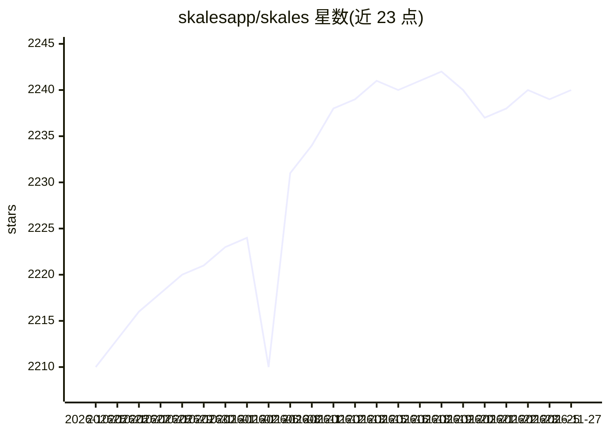

# skalesapp/skales

⭐ 2,240 · NOASSERTION · 推送 2026-11-24 · [GitHub](https://github.com/skalesapp/skales) · [官网](https://skales.app) · 组织维护

**面向普通用户的桌面/手机个人 AI agent 应用，本地运行多步骤任务**

Skales 是一个安装在用户自己电脑上的个人 AI agent 桌面应用（另有 Android/iOS 版），可访问本地文件、浏览器、日历和邮箱并自主执行多步骤工作。核心机制包括：持久化 Scout agent（可运行在独立虚拟机中）、/goal 后台长期任务、/code 文件夹级编码、Flow 自动化、电脑操作与浏览器控制、MCP 支持、语音输入。采用 BYOK 模式（15+ 提供商或任意 Chat Completions 兼容端点），提供无需 API key 的内置试用 Skales IQ，也可通过 Ollama 完全离线运行。提供一键安装包，无需 Docker 和终端。

## 筛选速览

| 维度 | 判定 | 备注 |
|---|---|---|
| AI 角色 | `ai-native` | 本体是模型或模型工具 |
| 许可风险 | `none` | NOASSERTION |
| 部署形态 | `desktop` | 安装包/桌面程序 |
| 模型依赖 | local-ok | 支持本地模型 |
| 硬件要求 | — | 无带数字的原话,不猜 |
| 安装摩擦 | `low` | 无编译、无系统依赖或容器化 |
| 成熟度 | — | 结构信号不足 |

## 能力要点

- 持久化 Scout agent，可选独立虚拟机隔离运行
- 15+ 提供商 BYOK 或经 Ollama 完全离线运行
- /goal 后台多步骤任务与 /code 文件夹级编码（git diff 与撤销）
- Windows/macOS/Linux/Android/iOS 一键安装，无需 Docker 与终端

## 适用场景

- 让 AI 在本机自主执行多步骤任务并随时接管审批
- 在本地文件夹上做带 diff 和撤销的编码工作
- 通过手机远程查看和操控桌面 agent
- 无网络或不愿付费时用本地模型离线使用

## 场景标签

`AI 助手` `GUI 自动化` `浏览器自动化` · 领域:效率与自动化

## 证据(README 行号)

> L39: An AI agent that runs on your own computer, with access to your files, browser, calendar and email, and does multi-
> L22:  One-click install. No Docker, no terminal. Start instantly with Skales IQ, a free built-in trial that needs no API

## 星数曲线

2026-10-25 2,210 → 2026-11-27 2,240（+30）

---
*卡片 v1 · prompt 1.4 · 生成 2026-11-26 · 置信度 high · 依据 README sha `147e629a77b9` · [字段定义](../../DATASET.md)*
