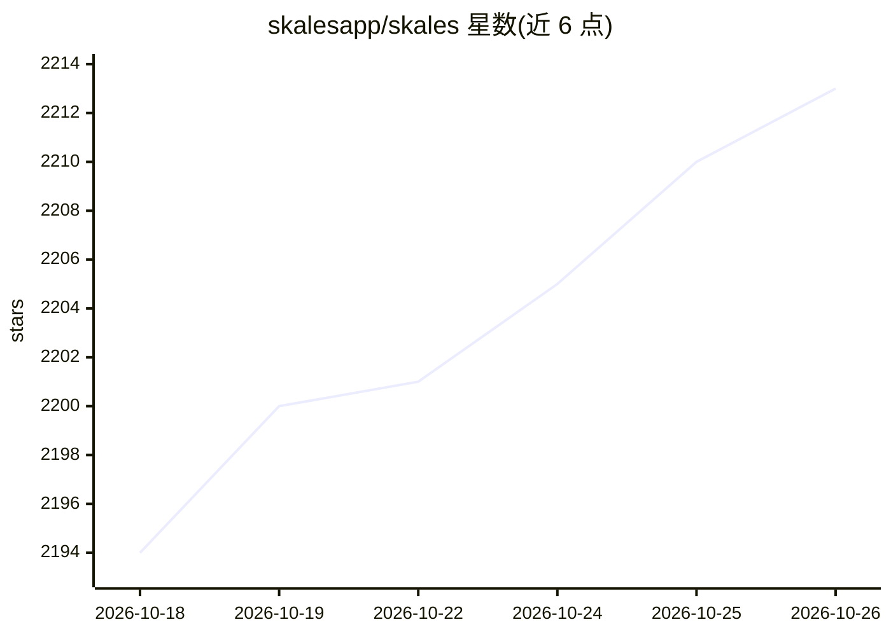

# skalesapp/skales

⭐ 2,213 · NOASSERTION · 推送 2026-10-22 · [GitHub](https://github.com/skalesapp/skales) · [官网](https://skales.app) · 组织维护

**跨平台个人 AI agent 桌面应用：本地运行、自主执行任务与编程**

面向非开发者用户的桌面/移动 AI agent：安装在 Windows/macOS/Linux 及 Android/iOS 上，可访问本机文件、浏览器、日历与邮件，以 /goal 后台多步执行任务、/code 绑定文件夹编程（四种审批模式、内联 diff、一键撤销）、/swarm 将任务发往配对设备，并支持 Agent 团队面板监控。模型接入为 BYOK：15+ 供应商、本地 Ollama 离线运行或任意 Chat Completions/Anthropic Messages/OpenAI Responses 端点。注意：本仓库仅为分发仓库（发布、变更日志、issue），产品本身为专有软件，从 BSL 1.1 转为自有 EULA，商业使用需授权。

## 筛选速览

| 维度 | 判定 | 备注 |
|---|---|---|
| AI 角色 | `ai-native` | 本体是模型或模型工具 |
| 许可风险 | `none` | NOASSERTION |
| 部署形态 | `None` |  |
| 模型依赖 | local-ok | 支持本地模型 |
| 硬件要求 | — | 无带数字的原话,不猜 |
| 安装摩擦 | `low` | 无编译、无系统依赖或容器化 |
| 成熟度 | — | 结构信号不足 |

## 能力要点

- 15+ AI 供应商 BYOK，或 Ollama 完全离线运行
- /goal 后台自主多步任务，可定时重复并断点续跑
- /code 文件夹级编程：Plan/Code/Edits/Auto 四模式与 git 内联 diff、一键撤销
- 手机经 QR 配对驱动桌面全套工具，WhatsApp/Telegram 可触达

## 适用场景

- 交给它一个目标（如搭交易机器人），合上盖子让它在后台自己完成
- 在本地对项目文件夹做 AI 编程，逐文件审批与撤销
- 多台设备配对后组成 agent 团队分担同一任务
- 完全离线用本地模型处理文件，数据不出本机

## 场景标签

`AI 助手` `编码 Agent` `多智能体` · 领域:Agent 开发

## 证据(README 行号)

> L37: An AI agent that runs on your own computer, with access to your files, browser, calendar and email, and does multi-
> L20:  One-click install. No Docker, no terminal. Start instantly with Skales IQ, a free built-in trial that needs no API

## 星数曲线

2026-10-18 2,194 → 2026-10-26 2,213（+19）

---
*卡片 v1 · prompt 1.4 · 生成 2026-10-21 · 置信度 high · 依据 README sha `5a3c80b9074a` · [字段定义](../../DATASET.md)*
