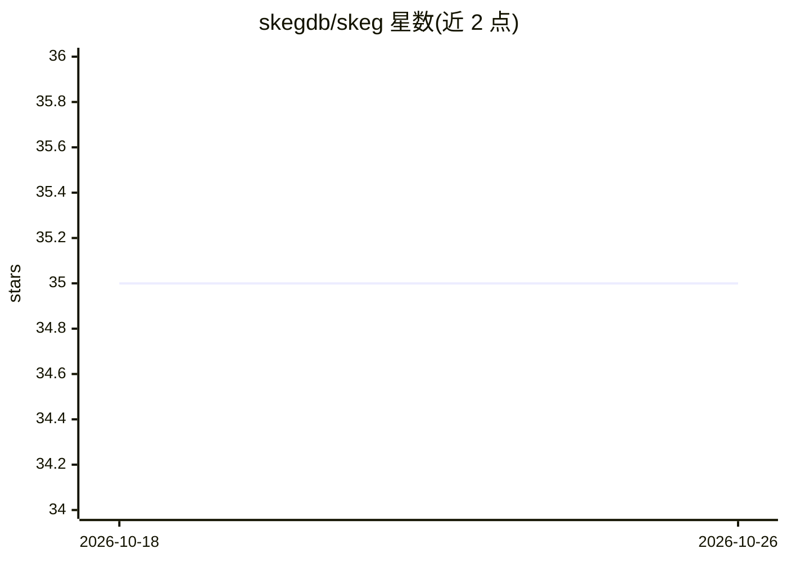

# skegdb/skeg

⭐ 35 · Rust · Apache-2.0 · 推送 2026-09-06 · [GitHub](https://github.com/skegdb/skeg) · 组织维护

**面向多租户的高内存效率向量数据库，兼容 Redis 协议**

Rust 编写的单进程向量数据库兼键值存储，对外讲 Redis（RESP3）协议，任意 Redis 客户端可直接连接。向量完整数据驻留 SSD，RAM 中仅保留量化工作集，通过量化代理走图检索并从磁盘全精度重排，宣称 memory 随工作集而非语料增长。多租户按存储布局隔离（每租户独立索引，配额与认证），支持范围/集合/布尔过滤语法与过滤规划器，六档向量精度分级。提供 Docker 镜像、Homebrew、cargo install 与预编译 tarball；限制：无 Intel Mac 与 Windows 构建，单进程吞吐上限约 780 QPS，冷批量加载较慢。

## 筛选速览

| 维度 | 判定 | 备注 |
|---|---|---|
| AI 角色 | `ai-ecosystem` | LLM/agent 周边工具 |
| 许可风险 | `permissive` | Apache-2.0 |
| 部署形态 | `self-host` | docker 或自建部署 |
| 模型依赖 | — | README 未给出锁定关系 |
| 硬件要求 | — | 无带数字的原话,不猜 |
| 安装摩擦 | `low` | 无编译、无系统依赖或容器化 |
| 成熟度 | — | 结构信号不足 |

## 能力要点

- 向量存 SSD、RAM 仅驻留量化工作集，README 称 100K×1024 维 recall 1.0 时 serve RAM 47 MB
- 每租户独立索引实现隔离，支持配额（SKEG.QUOTA）与 argon2id 认证
- Redis RESP3 协议兼容，任意 Redis 客户端可用，键值与向量同进程
- 六档向量精度（f32/int8/tq1/tq2/tq4/binary），按索引选择

## 适用场景

- 在同一台机器上跑多租户向量检索服务
- 让 3B LLM 与百万级向量索引共存做 RAG 而不爆内存
- 用现有 Redis 客户端直接接入向量与键值混合存储

## 场景标签

`向量数据库` · 领域:知识与检索

## 证据(README 行号)

> L16: skeg is a vector database and key-value store in one process, speaking the Redis
> L17: protocol. The full vectors stay on SSD and only a small quantized working set
> L61: **Recall 1.000, without the corpus in RAM.** A quantized proxy walks the graph

## 星数曲线

2026-10-18 35 → 2026-10-26 35（+0）

---
*卡片 v1 · prompt 1.4 · 生成 2026-10-25 · 置信度 high · 依据 README sha `4eef2d5cb44e` · [字段定义](../../DATASET.md)*
