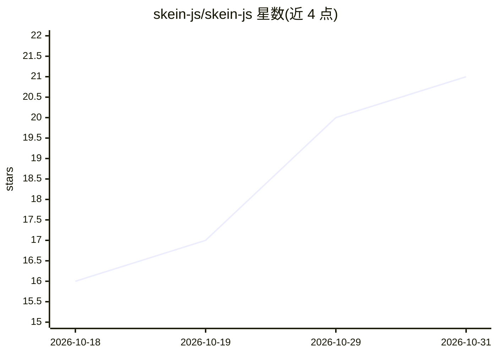

# skein-js/skein-js

⭐ 21 · TypeScript · Apache-2.0 · 推送 2026-10-26 · [GitHub](https://github.com/skein-js/skein-js) · [官网](https://skein-js.github.io/skein-js/) · 组织维护

**自托管 LangGraph.js agent 的 TypeScript 运行时服务**

开源的 TypeScript 运行时，将 LangGraph.js 编排的 agent 图部署为自有基础设施上的服务：提供 Agent Protocol HTTP/流式 API、基于 Postgres/SQLite 的会话状态与长期记忆、人工审批与检查点回溯、后台任务与定时调度、webhook 通道，以及随进程提供的控制台。定位为 LangGraph Platform（现 LangSmith Deployment）的 Apache-2.0 替代，兼容 LangGraph CLI 与 SDK 客户端。项目自述处于 pre-alpha 阶段但已可端到端运行。

## 筛选速览

| 维度 | 判定 | 备注 |
|---|---|---|
| AI 角色 | `ai-ecosystem` | LLM/agent 周边工具 |
| 许可风险 | `permissive` | Apache-2.0 |
| 部署形态 | `library` | 以包/库形式分发 |
| 模型依赖 | — | README 未给出锁定关系 |
| 硬件要求 | — | 无带数字的原话,不猜 |
| 安装摩擦 | `low` | 无编译、无系统依赖或容器化 |
| 成熟度 | `idea` | |

## 能力要点

- 提供 Agent Protocol HTTP/流式 API，兼容 LangGraph SDK 与 Agent Chat UI
- 会话状态与长期记忆，Postgres（共享）或 SQLite（本地）持久化
- 人工审批（interrupt 暴露）、检查点回溯、后台任务与定时调度
- 自带控制台：playground、运行跟踪、审批管理（生产默认关闭）

## 适用场景

- 在自有服务器上部署 LangGraph.js agent，替代 LangGraph Platform 托管
- 构建带人工审批等待环节的客服助手或研究工具
- 将 agent 图挂载进已有的 Express/Fastify/NestJS/Next.js 后端
- 本地单进程（SQLite）运行桌面应用或 CLI 中的 agent

## 场景标签

`Agent 框架` `Agent 记忆` · 领域:Agent 开发

## 证据(README 行号)

> L7: skein-js is an open-source TypeScript runtime for hosting
> L19: your infrastructure or inside an application you already ship. It is an Apache-2.0 alternative to

## 星数曲线

2026-10-18 16 → 2026-10-31 21（+5）

---
*卡片 v1 · prompt 1.4 · 生成 2026-10-28 · 置信度 high · 依据 README sha `333d41e48100` · [字段定义](../../DATASET.md)*
