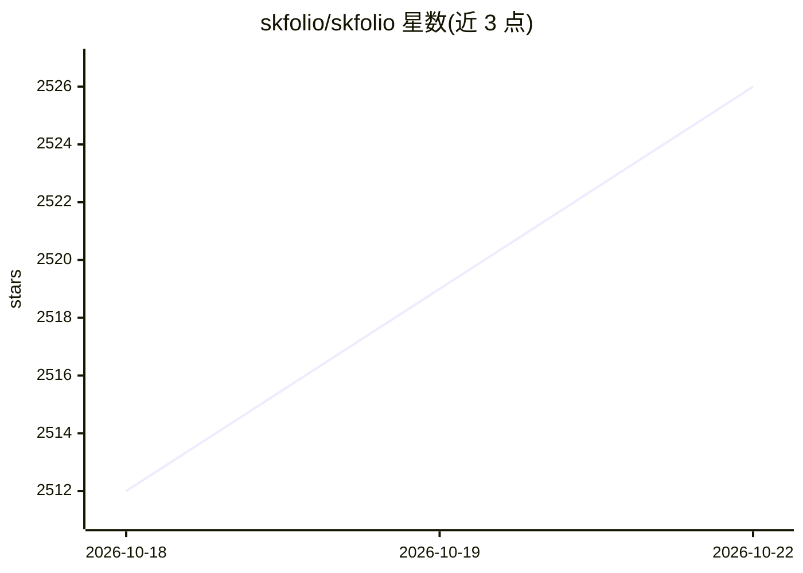

# skfolio/skfolio

⭐ 2,531 · Python · BSD-3-Clause · 推送 2026-10-22 · [GitHub](https://github.com/skfolio/skfolio) · [官网](https://skfolio.org) · 组织维护

**面向量化投资的 Python 组合优化库，基于 scikit-learn API**

Python 库，提供组合优化、因子模型构建与风险管理功能，构建在 scikit-learn 之上，遵循其 estimator/pipeline 接口。覆盖均值-风险、层次风险平价、分布鲁棒 CVaR 等优化模型，以及先验/协方差/分布/不确定性集估计器、18 种以上风险度量、Walk Forward 与组合净化交叉验证、交易成本与多种权重约束。供量化研究人员与开发者用统一机器学习框架做模型选择、调参和样本外验证以降低数据泄漏与过拟合风险。由 Skfolio Labs 提供企业支持与 SLA，本体以 BSD 3-Clause 开源分发。

## 筛选速览

| 维度 | 判定 | 备注 |
|---|---|---|
| AI 角色 | `ai-native` | 本体是模型或模型工具 |
| 许可风险 | `permissive` | BSD-3-Clause |
| 部署形态 | `library` | 以包/库形式分发 |
| 模型依赖 | — | README 未给出锁定关系 |
| 硬件要求 | — | 无带数字的原话,不猜 |
| 安装摩擦 | `low` | 无编译、无系统依赖或容器化 |
| 成熟度 | — | 结构信号不足 |

## 能力要点

- 基于 scikit-learn API 的统一组合建模/交叉验证/调参框架
- 凸优化、层次聚类、集成（Stacking）等多类组合优化模型
- 46 个描述因子（17 族）的横截面因子模型与多种先验估计器
- 18 种以上风险度量与交易成本、 Cardinality 等约束支持

## 适用场景

- 在 Python 中做均值-方差或风险平价组合优化
- 构建并回测横截面/时序因子模型
- 用 Walk Forward 与组合净化交叉验证降低过拟合与数据泄漏
- 在含交易成本与权重约束下生成目标组合权重

## 场景标签

`金融量化` · 领域:学习与行业

## 证据(README 行号)

> L52: **skfolio** is a Python library for portfolio optimization, factor model construction,
> L53: and risk management built on top of scikit-learn. It offers a unified interface and
> L141: This framework is built on scikit-learn's API.

## 星数曲线

2026-10-18 2,512 → 2026-10-22 2,526（+14）

---
*卡片 v1 · prompt 1.4 · 生成 2026-10-21 · 置信度 high · 依据 README sha `7a5ab14ca30e` · [字段定义](../../DATASET.md)*
