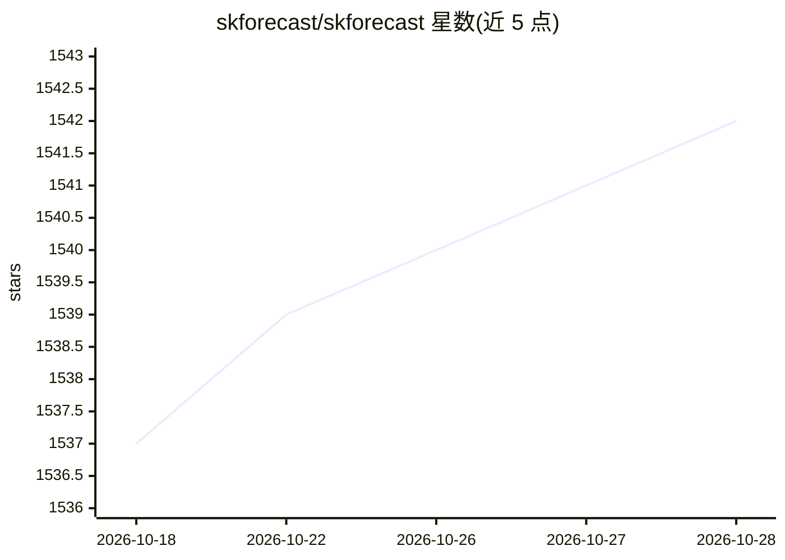

# skforecast/skforecast

⭐ 1,542 · Python · BSD-3-Clause · 推送 2026-10-28 · [GitHub](https://github.com/skforecast/skforecast) · [官网](https://skforecast.org) · 组织维护

**Python 时间序列预测库：统一 API 训练/回测机器学习与统计模型**

面向数据科学与生产环境的时间序列预测 Python 库：以统一 API 封装任意 scikit-learn 兼容回归器（LightGBM/XGBoost/CatBoost）、ARIMA/SARIMAX/ETS 等统计模型、Keras RNN/LSTM，以及 Chronos-2、TimesFM、Moirai-2、TabPFN-TS 等预训练基础模型的零样本预测。提供回测（含重训练/间隔/滑动窗口）、概率预测、Optuna 调参、全局多序列建模与特征工程。附带 skforecast-ai 助手、MCP server 与无代码 Studio。BSD-3-Clause 许可，NumFOCUS 附属项目。

## 筛选速览

| 维度 | 判定 | 备注 |
|---|---|---|
| AI 角色 | `ai-native` | 本体是模型或模型工具 |
| 许可风险 | `permissive` | BSD-3-Clause |
| 部署形态 | `library` | 以包/库形式分发 |
| 模型依赖 | — | README 未给出锁定关系 |
| 硬件要求 | — | 无带数字的原话,不猜 |
| 安装摩擦 | `low` | 无编译、无系统依赖或容器化 |
| 成熟度 | — | 结构信号不足 |

## 能力要点

- 统一 API 覆盖机器学习/统计/深度学习/基础模型四类预测器
- 回测支持重训练、间隔、fold 步长与固定/扩展窗口
- 概率预测（bootstrapping/conformal/分位数）与 CRPS 评估
- 附带 MCP server、Claude Code 插件与 llms.txt 供 AI 助手生成代码

## 适用场景

- 用 LightGBM/XGBoost 等回归器做单序列或多序列时间序列预测
- 在真实使用方式下回测与调参，评估模型上线表现
- 零样本调用 Chronos-2/TimesFM 等预训练基础模型做预测
- 让编码 agent 通过 MCP 或插件用自然语言生成预测脚本

## 场景标签

 · 领域:数据科学/时间序列预测

## 证据(README 行号)

> L12: **Time series forecasting, from prototype to production.** Skforecast is a Python library for time series forecasti
> L49: - **Foundation models**: zero-shot forecasting with pre-trained models such as Chronos-2, TimesFM, Moirai-2 or TabP

## 星数曲线

2026-10-18 1,537 → 2026-10-28 1,542（+5）

---
*卡片 v1 · prompt 1.4 · 生成 2026-10-21 · 置信度 mid · 依据 README sha `1080da27ce2c` · [字段定义](../../DATASET.md)*
