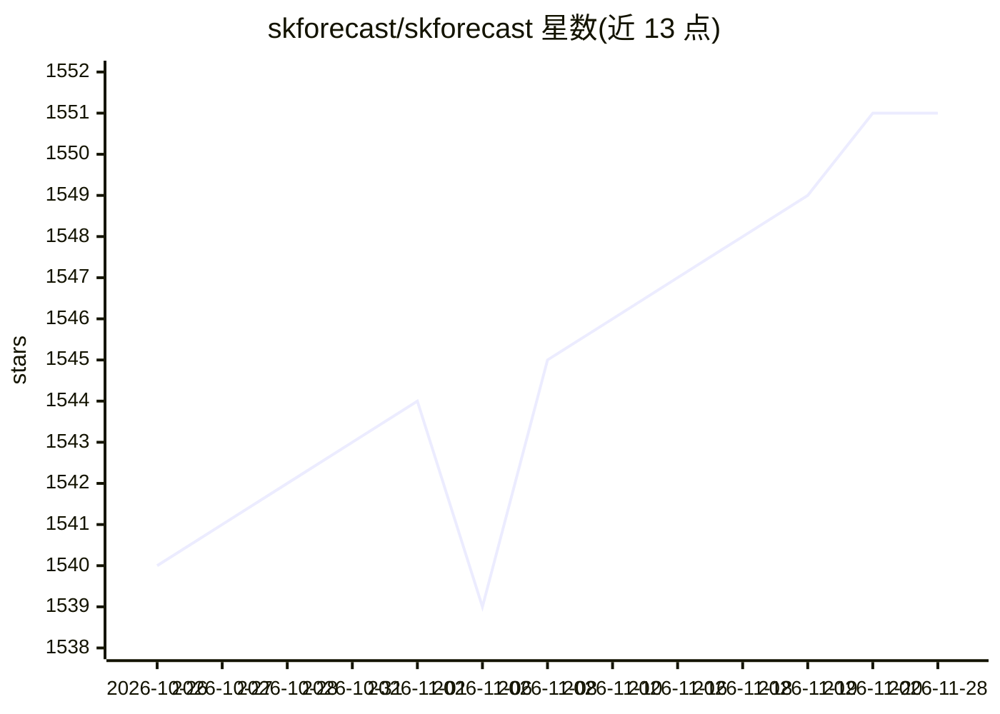

# skforecast/skforecast

⭐ 1,551 · Python · BSD-3-Clause · 推送 2026-11-27 · [GitHub](https://github.com/skforecast/skforecast) · [官网](https://skforecast.org) · 组织维护 · 中文 README

**时间序列预测 Python 库：统一接口训练、评估与部署预测模型**

面向数据科学与工程团队的时间序列预测库，统一封装四类模型：scikit-learn 兼容回归器（LightGBM/XGBoost/CatBoost）、预训练基础模型（Chronos-2、TimesFM 等零样本预测）、统计模型（ARIMA/SARIMAX/ETS）与 Keras 深度学习模型。核心机制包括递归/直接多步预测策略、多序列全局模型、回测、概率预测（conformal prediction/分位数）、Optuna 调参与漂移监测。经 pip/conda 安装，另提供 MCP server 与无代码工具 Skforecast Studio。

## 筛选速览

| 维度 | 判定 | 备注 |
|---|---|---|
| AI 角色 | `ai-native` | 本体是模型或模型工具 |
| 许可风险 | `permissive` | BSD-3-Clause |
| 部署形态 | `library` | 以包/库形式分发 |
| 模型依赖 | — | README 未给出锁定关系 |
| 硬件要求 | — | 无带数字的原话,不猜 |
| 安装摩擦 | `low` | 无编译、无系统依赖或容器化 |
| 成熟度 | — | 结构信号不足 |

## 能力要点

- 统一 API 覆盖机器学习、统计、深度学习与基础模型四类预测方法
- 回测机制支持 refit、gap、固定/扩展窗口等生产场景模拟
- 概率预测含 bootstrapping、conformal prediction 与 CRPS 评估
- 发布 llms.txt、Claude Code 插件与 MCP server 供 AI 辅助编码

## 适用场景

- 为单条或多条时间序列训练并回测预测模型
- 用 Chronos-2 等基础模型零样本生成预测
- 带外生变量（温度、节假日）的电力需求等业务预测
- 通过自然语言让 coding agent 产出预测脚本与回测指标

## 场景标签

 · 领域:数据科学/时间序列预测

## 证据(README 行号)

> L12: **Time series forecasting, from prototype to production.** Skforecast is a Python library for time series forecasti
> L48: - **Machine learning**: any scikit-learn compatible regressor, such as LightGBM, XGBoost or CatBoost, with lags, ro
> L53: Train, predict, tune and backtest the same way, whatever the model: see them compared on three datasets.

## 星数曲线

2026-10-26 1,540 → 2026-11-28 1,551（+11）

---
*卡片 v1 · prompt 1.4 · 生成 2026-11-23 · 置信度 mid · 依据 README sha `2e9c566e450d` · [字段定义](../../DATASET.md)*
