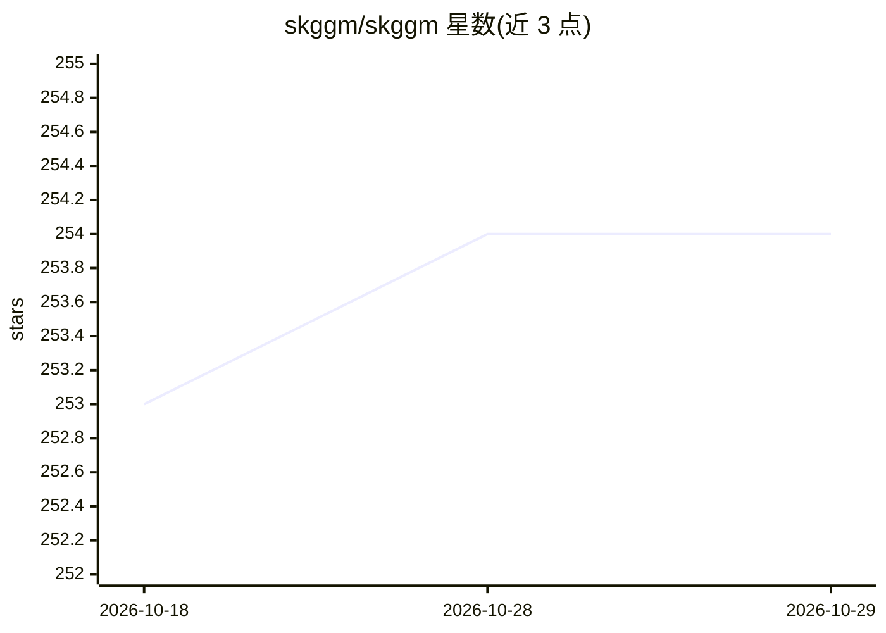

# skggm/skggm

⭐ 254 · Python · MIT · 推送 2026-06-23 · [GitHub](https://github.com/skggm/skggm) · [官网](https://skggm.github.io/skggm/tour) · 组织维护

**scikit-learn 兼容的高斯图模型/逆协方差估计 Python 库**

提供图形 lasso 的 scikit-learn 兼容实现集合，核心是 QUIC 算法封装（QuicGraphicalLasso，支持标量或矩阵惩罚、path 模式），并附交叉验证选参（CV）、EBIC 模型选择、ModelAverage 集成元估计器（bootstrap + 随机惩罚的稳定性选择）、AdaptiveGraphicalLasso 两步估计等。支持 joblib 与 Apache Spark 并行。面向统计/机器学习研究者和数据分析师，用于从高维数据估计精度矩阵与条件独立性网络（如基因调控、神经交互）。当前聚焦高斯图模型，计划扩展到广义图模型。依赖 numpy/scipy/cython 需预装，QUIC 绑定需 lapack 与编译。

## 筛选速览

| 维度 | 判定 | 备注 |
|---|---|---|
| AI 角色 | `ai-native` | 本体是模型或模型工具 |
| 许可风险 | `permissive` | MIT |
| 部署形态 | `library` | 以包/库形式分发 |
| 模型依赖 | — | README 未给出锁定关系 |
| 硬件要求 | — | 无带数字的原话,不猜 |
| 安装摩擦 | `low` | 无编译、无系统依赖或容器化 |
| 成熟度 | — | 结构信号不足 |

## 能力要点

- QUIC 算法的 scikit-learn 兼容估计器，支持矩阵惩罚与 path 模式
- ModelAverage 稳定性选择：bootstrap 子采样与随机惩罚，输出非零概率矩阵
- AdaptiveGraphicalLasso 两步自适应重拟合（binary、1/|coeffs|、1/|coeffs|^2）
- joblib 与 Apache Spark 并行支持（n_jobs / sc 参数）

## 适用场景

- 从高维数据估计逆协方差/精度矩阵
- 推断基因调控网络或神经交互网络
- 用 CV 或 EBIC 做图形 lasso 模型选择
- 基准测试不同图结构下的估计方法（MonteCarloProfiling）

## 场景标签

 · 领域:机器学习/统计计算

## 证据(README 行号)

> L5: # skggm : Gaussian graphical models using the scikit-learn API
> L15: Given **n** independently drawn, **p**-dimensional Gaussian random samples X with sample covariance S, the maximum 
> L25: In this package we provide a scikit-learn-compatible implementation of the program above and a collection of modern

## 星数曲线

2026-10-18 253 → 2026-10-29 254（+1）

---
*卡片 v1 · prompt 1.4 · 生成 2026-10-22 · 置信度 high · 依据 README sha `6cc0ac6647d9` · [字段定义](../../DATASET.md)*
