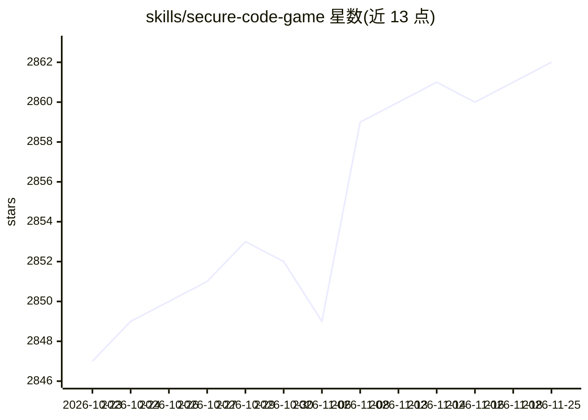

# skills/secure-code-game

⭐ 2,862 · JavaScript · MIT · 推送 2026-11-01 · [GitHub](https://github.com/skills/secure-code-game) · [官网](https://gh.io/scg) · 组织维护

**浏览器内开玩的安全编码教学游戏，面向开发者与学生**

GitHub 维护的开源在编辑器安全编码练习游戏，共四个 Season：Season 1/2 覆盖 Python、C、Go、JavaScript 及 CI/CD 的安全编码基础，Season 3/4 覆盖 LLM 安全、Agentic 工作流与多智能体通信的安全风险。通过 GitHub Codespaces 在浏览器中游玩，无需本地环境；README 警告 Season 3 为历史学习材料、Season 4 暂停迁移至新模型后端，两者仍可只读浏览挑战、源码、提示与解答。

## 筛选速览

| 维度 | 判定 | 备注 |
|---|---|---|
| AI 角色 | `ai-knowledge` | 知识聚合/清单类 |
| 许可风险 | `permissive` | MIT |
| 部署形态 | `None` |  |
| 模型依赖 | — | README 未给出锁定关系 |
| 硬件要求 | — | 无带数字的原话,不猜 |
| 安装摩擦 | `low` | 无编译、无系统依赖或容器化 |
| 成熟度 | — | 结构信号不足 |

## 能力要点

- 四个 Season：安全编码基础（Python/C）与多栈安全（含 CodeQL、CI/CD）
- Season 3/4 覆盖 LLM 安全、Agentic 工作流与多智能体通信安全
- 通过 GitHub Codespaces 在浏览器开玩，无需本地搭建
- MIT 许可，社区可通过贡献参与改进

## 适用场景

- 作为开发者学习安全编码的入门练习
- 以案例研究方式阅读 LLM 与 Agent 安全的挑战与解答
- 教学中向学生分发即开即用的安全练习仓库

## 场景标签

`网络安全` `教程课程` · 领域:学习与行业

## 证据(README 行号)

> L16: Learn to code securely while having fun through our popular open source in-editor experience, designed for develope
> L26: |**Season 4**|Agentic&nbsp;AI|Study security risks in AI agents that execute commands, browse the web, use tools, a
> L33: |**Season 2**|Multi-Stack|Security across CI/CD, backend services, and web apps with CodeQL *Uses `GitHub Actions`,

## 星数曲线

2026-10-23 2,847 → 2026-11-25 2,862（+15）

---
*卡片 v1 · prompt 1.4 · 生成 2026-11-23 · 置信度 high · 依据 README sha `6868a7b51a68` · [字段定义](../../DATASET.md)*
