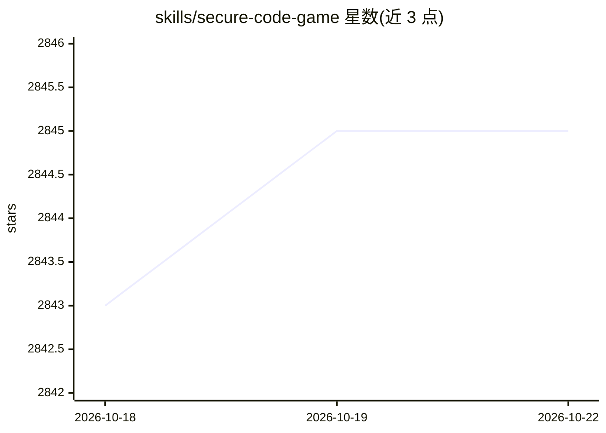

# skills/secure-code-game

⭐ 2,847 · JavaScript · MIT · 推送 2026-10-21 · [GitHub](https://github.com/skills/secure-code-game) · [官网](https://gh.io/scg) · 组织维护

**GitHub 出品的浏览器内安全编码闯关课程，含 AI 安全季**

开源的在编辑器内安全编码学习游戏，面向开发者、学生与安全爱好者，浏览器中两分钟内开始，累计超 10,000 名玩家。内容按季组织：Season 4 主题为 Agentic AI 安全（在交互式 AI 编码助手中练习命令执行、工具调用、多智能体通信的安全防护），Season 3 为 LLM 安全（提示设计、输入输出处理、数据源防护），Season 1-2 覆盖 Python/C/Go/JS 与 CI/CD 的安全编码基础。通过 GitHub 模板仓库 + Codespaces 运行，各季独立无需前置。

## 筛选速览

| 维度 | 判定 | 备注 |
|---|---|---|
| AI 角色 | `ai-knowledge` | 知识聚合/清单类 |
| 许可风险 | `permissive` | MIT |
| 部署形态 | `None` |  |
| 模型依赖 | — | README 未给出锁定关系 |
| 硬件要求 | — | 无带数字的原话,不猜 |
| 安装摩擦 | `low` | 无编译、无系统依赖或容器化 |
| 成熟度 | — | 结构信号不足 |

## 能力要点

- Season 4 聚焦 Agentic AI 工作流与多智能体通信安全（5 个递进关卡）
- Season 3 聚焦 LLM 应用安全（提示设计、输入输出处理、数据源防护）
- 浏览器内基于 GitHub Codespaces 即开即玩，各季自包含
- 覆盖 CodeQL、CI/CD、多语言安全编码基础

## 适用场景

- 我想通过闯关游戏学习 AI agent 与 LLM 应用的安全防护
- 系统学习 Web、系统编程与 CI/CD 场景下的安全编码
- 高校或企业内组织安全编码练习（开源可自由部署）

## 场景标签

`网络安全` `教程课程` · 领域:学习与行业

## 证据(README 行号)

> L11: Learn to code securely while having fun through our popular open source in-editor experience, designed for develope
> L13: In the latest season, you step inside a fully interactive AI coding assistant that turns natural language into bash
> L19: |Season&nbsp;&nbsp;&nbsp;&nbsp;&nbsp;&nbsp;&nbsp;&nbsp;&nbsp;&nbsp;|Focus&nbsp;&nbsp;&nbsp;&nbsp;&nbsp;&nbsp;&nbsp;

## 星数曲线

2026-10-18 2,843 → 2026-10-22 2,845（+2）

---
*卡片 v1 · prompt 1.4 · 生成 2026-10-21 · 置信度 high · 依据 README sha `43ab2224dff2` · [字段定义](../../DATASET.md)*
