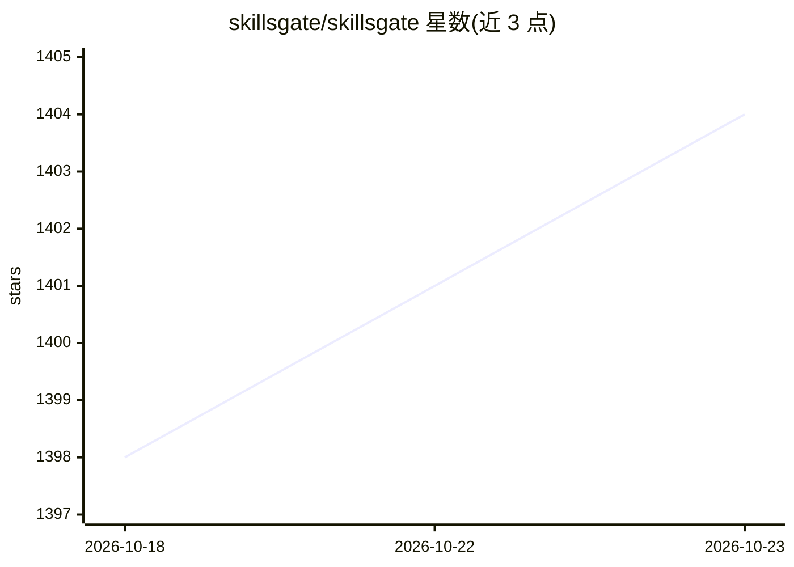

# skillsgate/skillsgate

⭐ 1,404 · TypeScript · MIT · 推送 2026-10-13 · [GitHub](https://github.com/skillsgate/skillsgate) · [官网](https://skillsgate.ai/) · 组织维护

**可视化 AI agent 技能管理器：浏览/安装/管理 20+ agent 的技能**

面向使用 AI agent 的用户的桌面应用（Electron），集成 skills.sh 公共技能目录，可在单一界面浏览、搜索、一键安装技能到任意 agent 组合，并支持按 agent 分别管理、内置 CodeMirror 编辑器、SSH 远程同步、私有技能与本地 SQLite 存储。兼容 Claude Code、Cursor、GitHub Copilot 等 25 个 agent。提供 macOS/Windows/Linux 安装包；早期终端 UI（npm 包）已弃用，改用桌面应用。

## 筛选速览

| 维度 | 判定 | 备注 |
|---|---|---|
| AI 角色 | `ai-ecosystem` | LLM/agent 周边工具 |
| 许可风险 | `permissive` | MIT |
| 部署形态 | `desktop` | 安装包/桌面程序 |
| 模型依赖 | — | README 未给出锁定关系 |
| 硬件要求 | — | 无带数字的原话,不猜 |
| 安装摩擦 | `low` | 无编译、无系统依赖或容器化 |
| 成熟度 | — | 结构信号不足 |

## 能力要点

- 支持 25 个 agent 的技能安装与管理
- 集成 skills.sh 公共技能目录的浏览与搜索
- 内置编辑器、SSH 远程同步、私有技能与收藏功能
- 本地优先：设置存于本地 SQLite，无需账号

## 适用场景

- 我想不用手动复制 markdown 就能给多个 agent 装技能
- 统一管理不同 agent 上已安装的技能
- 团队内共享私有技能并在远程机器间同步

## 场景标签

`提示工程` · 领域:Agent 开发

## 证据(README 行号)

> L7:  Visual skill manager for AI agents.
> L20: SkillsGate lets you browse, install, and manage AI agent skills from a single interface. It works with 20+ agents a
> L36: Claude Code, Cursor, Windsurf, GitHub Copilot, Cline, Continue, Codex CLI, Droid CLI, OB-1, Amp, Goose, Junie, Kilo

## 星数曲线

2026-10-18 1,398 → 2026-10-23 1,404（+6）

---
*卡片 v1 · prompt 1.4 · 生成 2026-10-21 · 置信度 mid · 依据 README sha `a53f3b8da5c9` · [字段定义](../../DATASET.md)*
