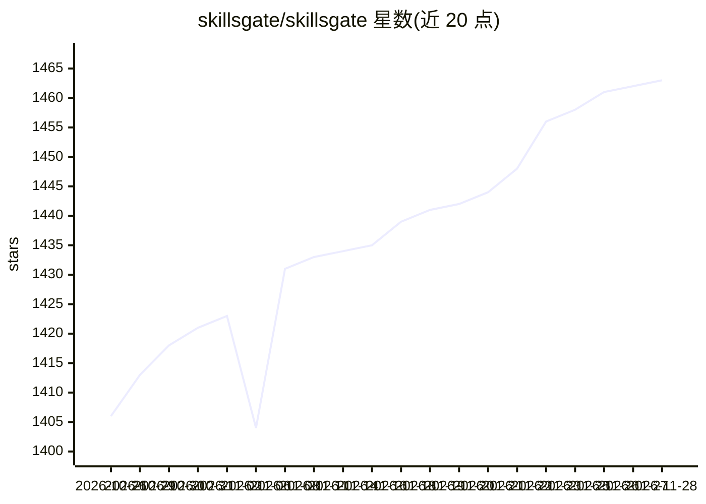

# skillsgate/skillsgate

⭐ 1,463 · TypeScript · MIT · 推送 2026-11-15 · [GitHub](https://github.com/skillsgate/skillsgate) · [官网](https://skillsgate.ai/) · 组织维护

**AI agent 技能的可视化管理桌面应用**

跨平台桌面应用，用于浏览、安装和管理 AI agent 的技能文件：集成 skills.sh 公共技能目录供搜索与发现，可按 agent 单独或批量安装/卸载技能，内置 CodeMirror 编辑器查看与修改技能源文件，支持经 SSH 连接远程机器同步技能，数据存于本地 SQLite，无需账号。支持 20+ 个 agent（Claude Code、Cursor、Windsurf、GitHub Copilot 等），提供 macOS/Windows/Linux 安装包；早期 npm 终端 UI 版本已弃用。

## 筛选速览

| 维度 | 判定 | 备注 |
|---|---|---|
| AI 角色 | `ai-ecosystem` | LLM/agent 周边工具 |
| 许可风险 | `permissive` | MIT |
| 部署形态 | `desktop` | 安装包/桌面程序 |
| 模型依赖 | — | README 未给出锁定关系 |
| 硬件要求 | — | 无带数字的原话,不猜 |
| 安装摩擦 | `low` | 无编译、无系统依赖或容器化 |
| 成熟度 | — | 结构信号不足 |

## 能力要点

- 集成 skills.sh 公共技能目录，应用内浏览与搜索
- 对 20+ 个 agent 按目标单独或批量安装/移除技能
- 内置 CodeMirror 编辑器，修改即时写盘
- SSH 连接远程机器浏览与同步技能

## 适用场景

- 在多个 agent 之间统一安装和管理技能，替代手动复制 markdown 文件
- 为团队维护共享的私有技能库
- 通过 SSH 管理多台机器上的 agent 技能

## 场景标签

 · 领域:AI 工具/开发效率

## 证据(README 行号)

> L7:  Visual skill manager for AI agents.
> L20: SkillsGate lets you browse, install, and manage AI agent skills from a single interface. It works with 20+ agents a

## 星数曲线

2026-10-26 1,406 → 2026-11-28 1,463（+57）

---
*卡片 v1 · prompt 1.4 · 生成 2026-11-24 · 置信度 mid · 依据 README sha `cb23f1fa2265` · [字段定义](../../DATASET.md)*
