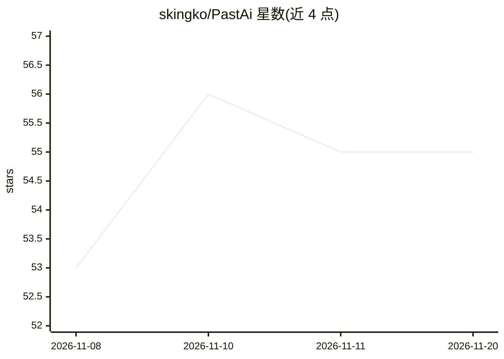

# skingko/PastAi

⭐ 55 · Swift · MIT · 推送 2026-11-03 · [GitHub](https://github.com/skingko/PastAi) · [官网](https://github.com/skingko/PastAi/releases/latest) · 个人维护 · 中文 README

**带 AI 代理的 macOS 剪贴板管理器与划词工具栏**

原生 Swift 编写的 macOS 剪贴板管理器：记录全格式剪贴板历史（文本/富文本/图片/音视频/文件），任意应用中选中文字可弹出 PopClip 式工具栏，内置 30 个扩展（含美国与中国服务）。AI 部分为自带模型（BYO model）代理，可搜索、整理、合并、改写剪贴库，支持 OpenAI 兼容协议与 Anthropic 原生 API，密钥存于 macOS Keychain。隐私机制包括本地存储、隐藏条目在数据库查询层过滤、改动需确认、一键撤销。要求 macOS 26+ 与 Apple Silicon，从 Releases 下载 DMG 安装。

## 筛选速览

| 维度 | 判定 | 备注 |
|---|---|---|
| AI 角色 | `ai-enhanced` | 去掉 AI 部分产品仍成立 |
| 许可风险 | `permissive` | MIT |
| 部署形态 | `None` |  |
| 模型依赖 | local-ok | 支持本地模型 |
| 硬件要求 | — | 无带数字的原话,不猜 |
| 安装摩擦 | `low` | 无编译、无系统依赖或容器化 |
| 成熟度 | — | 结构信号不足 |

## 能力要点

- 全格式剪贴板历史与 PopClip 式划词工具栏
- 自带模型 AI 代理：搜索/打标/合并/改写剪贴库，改动需确认且可撤销
- 30 个内置扩展，覆盖美国与中国服务，扩展市场直接从 GitHub 拉取
- 隐私机制：本地存储、隐藏条目数据库层过滤、代理无网络/文件/shell 工具

## 适用场景

- 管理和检索我复制过的所有内容，包括图片内 OCR 文字
- 选中文本后直接翻译、搜索或发送到其他应用
- 让 AI 代理帮我整理剪贴库、去重、把截图表格转成 CSV
- 用 Ollama/LM Studio 本地模型，数据不离开我的 Mac

## 场景标签

`OCR` `AI 助手` · 领域:对话与助手

## 证据(README 行号)

> L7: Clipboard history for every format, a PopClip-style toolbar on any selected text, and an AI agent that can search, o
> L22: PastAi is an open-source, native Mac clipboard manager in the spirit of Paste, with a text selection toolbar in the
> L121: Add a provider in **Settings > AI Models**. PastAi speaks the OpenAI-compatible protocol, which covers OpenAI, Goo

## 星数曲线

2026-11-08 53 → 2026-11-20 55（+2）

---
*卡片 v1 · prompt 1.4 · 生成 2026-11-18 · 置信度 high · 依据 README sha `0f3483bc93cb` · [字段定义](../../DATASET.md)*
