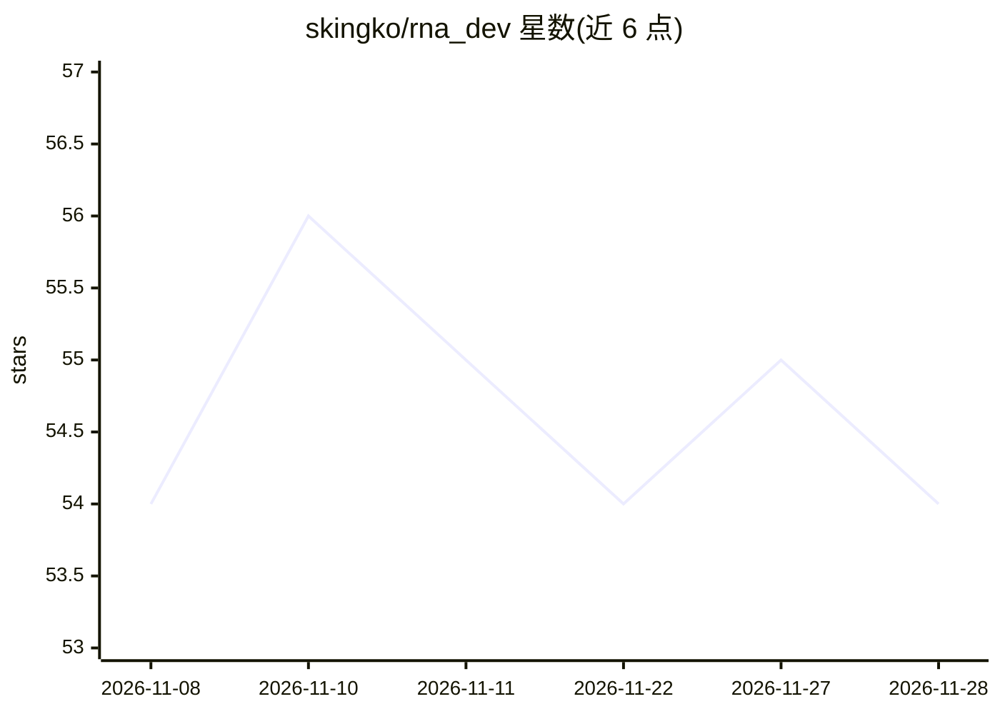

# skingko/rna_dev

⭐ 54 · JavaScript · Apache-2.0 · 推送 2026-10-23 · [GitHub](https://github.com/skingko/rna_dev) · [官网](https://www.rna.dev) · 个人维护 · 中文 README

**本地优先的 AI agent 工作台：面向长期项目的后台代理**

Rna Agent 是桌面应用加命令行，用于在超出单次对话周期的项目（游戏、小说、研究课题、代码库）上与 AI agent 协作。以项目为单位管理文件夹、记忆、技能与工具；agent 可在后台持续工作并生成摘要，小成本判定模型（JEV）在主模型写入前处理路由与筛选类决策。提供内置本地记忆（无需 Docker）或 OpenViking 语义记忆两种后端，支持六种网络搜索服务与 MCP。macOS 为主要开发平台，Linux/Windows 构建为 Preview，部分功能依赖 macOS 设施而受限。

## 筛选速览

| 维度 | 判定 | 备注 |
|---|---|---|
| AI 角色 | `ai-native` | 本体是模型或模型工具 |
| 许可风险 | `permissive` | Apache-2.0 |
| 部署形态 | `desktop` | 安装包/桌面程序 |
| 模型依赖 | locked-api |  |
| 硬件要求 | — | 无带数字的原话,不猜 |
| 安装摩擦 | `low` | 无编译、无系统依赖或容器化 |
| 成熟度 | `idea` | |

## 能力要点

- 项目为单位的记忆、技能与工具管理，支持后台调查与定时工作
- 内置本地记忆无需 Docker，可选 OpenViking 语义记忆后端
- 六种搜索服务（FastCRW/Firecrawl/Tavily/Brave/Zhipu/Bocha）统一为 web_search 与 web_fetch 两个工具
- 支持 DeepSeek、GLM、OpenAI 兼容端点、Anthropic、ChatGPT 订阅接入

## 适用场景

- 管理跨多天的项目，让 agent 在后台持续工作并汇报
- 本地保存对话、记忆与密钥，仅向自配的模型与搜索服务发起网络请求
- 通过 CLI 与桌面应用操作同一服务与项目

## 场景标签

`AI 助手` `Agent 记忆` · 领域:Agent 开发

## 证据(README 行号)

> L7: ### A local-first AI agent workbench for long-running projects.
> L21: Rna Agent is a desktop app and command line for working with AI agents on projects that last longer than one conver

## 星数曲线

2026-11-08 54 → 2026-11-28 54（+0）

---
*卡片 v1 · prompt 1.4 · 生成 2026-11-18 · 置信度 high · 依据 README sha `dcb6aaa0ea11` · [字段定义](../../DATASET.md)*
