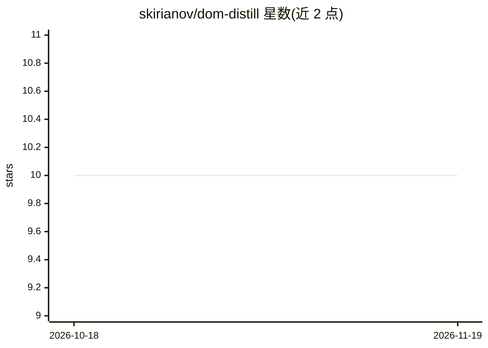

# skirianov/dom-distill

⭐ 10 · TypeScript · MIT · 推送 2026-03-08 · [GitHub](https://github.com/skirianov/dom-distill) · 个人维护

**面向 LLM 与浏览器自动化的 DOM 精简引擎，降低 token 消耗**

零依赖 TypeScript 库，在浏览器内（page.evaluate）将 DOM 转换为 LLM 可操作节点的最小 JSON 数组，以降低浏览器 agent 的 token 开销。节点附确定性 CSS selector、InteractionRank 评分（0-10+，基于标签语义、ARIA 角色与属性）与 selector 稳定性分数。支持过滤、压缩、指纹 diff（增量更新）、React Fiber 集成与 requestIdleCallback 分块异步遍历。通过 npm 安装，附带 Playwright 示例与 agent-loop 示例。

## 筛选速览

| 维度 | 判定 | 备注 |
|---|---|---|
| AI 角色 | `ai-ecosystem` | LLM/agent 周边工具 |
| 许可风险 | `permissive` | MIT |
| 部署形态 | `library` | 以包/库形式分发 |
| 模型依赖 | — | README 未给出锁定关系 |
| 硬件要求 | — | 无带数字的原话,不猜 |
| 安装摩擦 | `low` | 无编译、无系统依赖或容器化 |
| 成熟度 | — | 结构信号不足 |

## 能力要点

- DOM→结构化 JSON，示例站点 token 削减 90.7%–96.8%
- InteractionRank 评分与 selector 稳定性分数（data-testid→1.0，nth-of-type→0.3）
- 指纹 diff 支持增量更新而非整树重发
- 可选 React Fiber 集成，提取组件名并脱敏 props

## 适用场景

- 为浏览器自动化 agent 压缩页面 DOM 以减少 token 消耗
- 构建使用 LLM 决策动作的浏览器 agent 循环
- 对页面节点变化做增量 diff 更新

## 场景标签

`浏览器自动化` · 领域:效率与自动化

## 证据(README 行号)

> L13: `dom-distill` is a zero-dependency TypeScript engine that runs inside the browser (`page.evaluate`) and converts th
> L131: ### AI Agent Cookbook

## 星数曲线

2026-10-18 10 → 2026-11-19 10（+0）

---
*卡片 v1 · prompt 1.4 · 生成 2026-11-19 · 置信度 high · 依据 README sha `5e104f25e431` · [字段定义](../../DATASET.md)*
