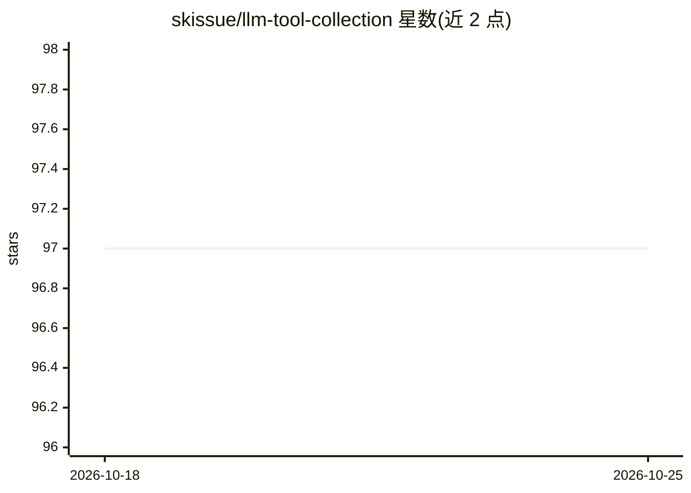

# skissue/llm-tool-collection

⭐ 97 · Emacs Lisp · GPL-3.0 · 推送 2026-02-26 · [GitHub](https://github.com/skissue/llm-tool-collection) · 个人维护

**Emacs LLM agent 的工具集：文件/缓冲区/搜索/系统类可调用工具**

为 Emacs 环境下的 agentic LLM 提供一组可调用工具的策展合集，覆盖四类：文件系统（创建/查看/编辑/glob/列目录）、缓冲区（查看/编辑/搜索）、搜索（递归 grep）与系统（执行 Bash、求值 Emacs Lisp）。每个工具以同时含变量与函数值的符号定义，变量承载工具规范，可传给任意兼容的 Emacs LLM 客户端。提供按类别、按标签获取工具的接口，支持 gptel 与 llm 两种客户端注册方式。未进入任何软件仓库，需 git clone 后加入 load-path 安装；贡献需用 deftool 宏并遵循去重叠的策展准则。

## 筛选速览

| 维度 | 判定 | 备注 |
|---|---|---|
| AI 角色 | `ai-ecosystem` | LLM/agent 周边工具 |
| 许可风险 | `viral` | GPL-3.0 |
| 部署形态 | `None` |  |
| 模型依赖 | — | README 未给出锁定关系 |
| 硬件要求 | — | 无带数字的原话,不猜 |
| 安装摩擦 | `low` | 无编译、无系统依赖或容器化 |
| 成熟度 | — | 结构信号不足 |

## 能力要点

- 16 个工具按 filesystem/buffers/search/system 四类组织，含标签与作者标注
- 每个工具符号同时含工具规范（变量值）与实现函数（函数值），兼容任意合规 Emacs LLM 客户端
- 提供 gptel 与 llm 两种客户端的工具注册示例
- 提供 llm-tool-collection-deftool 宏供贡献者定义新工具

## 适用场景

- 为 gptel 或 llm 客户端批量注册文件/缓冲区操作工具，让 LLM agent 操作 Emacs
- 按类别或标签挑选工具组合，构建自定义 agent 能力集
- 参考 deftool 宏扩写个人工具并回馈到合集

## 场景标签

`Agent 框架` · 领域:Agent 开发

## 证据(README 行号)

> L4: A curated collection of tools to empower Emacs-based LLM agents.
> L50: Every tool is defined with a symbol =llm-tc/tool-name= that has both a variable value and a function value. The var

## 星数曲线

2026-10-18 97 → 2026-10-25 97（+0）

---
*卡片 v1 · prompt 1.4 · 生成 2026-10-23 · 置信度 high · 依据 README sha `31101929cbe3` · [字段定义](../../DATASET.md)*
