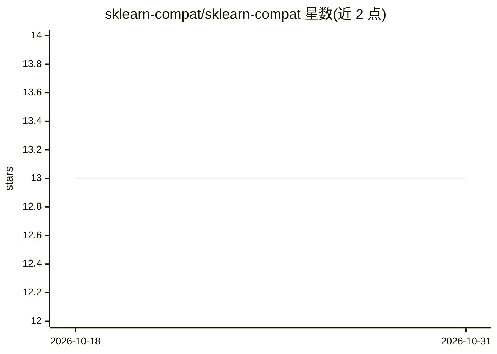

# sklearn-compat/sklearn-compat

⭐ 13 · Python · BSD-3-Clause · 推送 2026-09-21 · [GitHub](https://github.com/sklearn-compat/sklearn-compat) · [官网](https://sklearn-compat.readthedocs.io/en/latest/) · 组织维护

**帮助 scikit-learn 兼容库跨版本共存的 Python 兼容层**

由 imbalanced-learn、skrub、skops 等第三方库维护者共建的小型 Python 包：把各库为支持多个 scikit-learn 版本而重复实现的私有开发工具函数收敛到一个包中，随 scikit-learn 每次发布更新。覆盖 validate_data、_convert_container、_check_targets、estimator tags 等接口的改名/迁移/返回值变更，提供包装或 backport；也提供可 vendor 的单文件版本。遵循 SPEC 0，支持 scikit-learn >= 1.2、约近 4 个版本或 2 年。发布于 PyPI 与 conda-forge。

## 筛选速览

| 维度 | 判定 | 备注 |
|---|---|---|
| AI 角色 | `ai-ecosystem` | LLM/agent 周边工具 |
| 许可风险 | `permissive` | BSD-3-Clause |
| 部署形态 | `library` | 以包/库形式分发 |
| 模型依赖 | — | README 未给出锁定关系 |
| 硬件要求 | — | 无带数字的原话,不猜 |
| 安装摩擦 | `low` | 无编译、无系统依赖或容器化 |
| 成熟度 | — | 结构信号不足 |

## 能力要点

- 收敛多库重复实现的跨版本兼容工具函数，随 scikit-learn 发布更新
- 提供单文件 vendor 版本（src/sklearn_compat/_sklearn_compat.py），可不做包依赖
- 覆盖 1.5–1.9 的模块迁移、参数改名与 _check_targets 返回值变更
- 支持 scikit-learn >= 1.2，遵循 SPEC 0

## 适用场景

- 我维护的 sklearn 兼容估计器库要同时支持多个 scikit-learn 版本
- 不想在每个下游库里重复抄同一套版本适配代码
- 升级 scikit-learn 后快速迁移 validate_data、tags、testing helper 等私有接口

## 场景标签

 · 领域:机器学习工具链/库开发

## 证据(README 行号)

> L9: `sklearn-compat` is a small Python package that help developer writing scikit-learn
> L22: `scikit-learn` versions. We therefore decided to factorize these utilities in a

## 星数曲线

2026-10-18 13 → 2026-10-31 13（+0）

---
*卡片 v1 · prompt 1.4 · 生成 2026-10-31 · 置信度 high · 依据 README sha `d1ec5910bf1d` · [字段定义](../../DATASET.md)*
