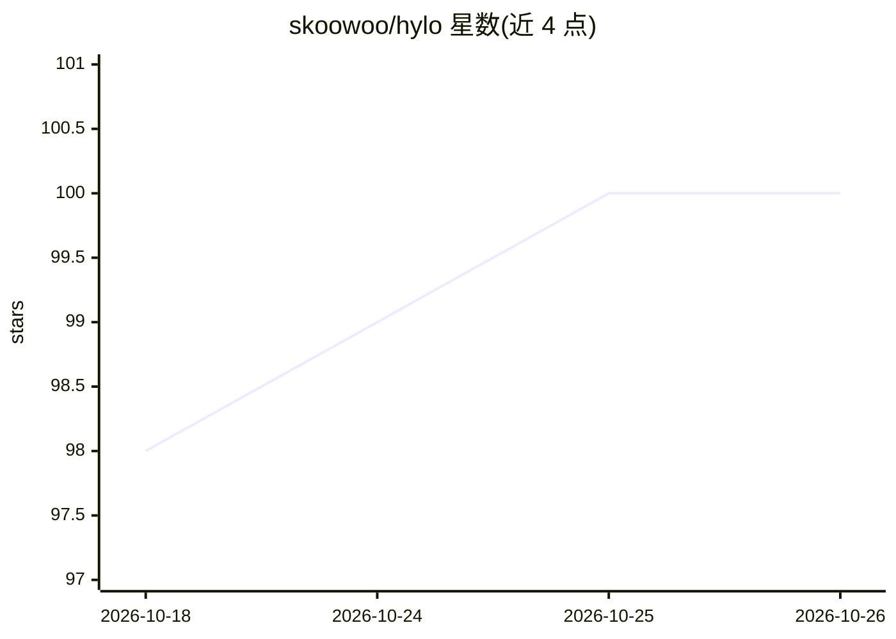

# skoowoo/hylo

⭐ 100 · Go · Apache-2.0 · 推送 2026-10-25 · [GitHub](https://github.com/skoowoo/hylo) · [官网](https://skoo.build/apps/hylo) · 个人维护 · 中文 README

**个人笔记驱动的自托管 AI agent，兼容 Obsidian**

面向个人用户的知识型笔记系统与 AI agent 平台：内置 WYSIWYG 编辑器、Wikilink、短笔记流、Raycast 式即时搜索与网页剪藏扩展，与 Obsidian 共用同一 vault、读写标准 Markdown。AI 侧自动发现 PATH 中的 6 种 agent CLI（Claude Code、OpenCode、Codex 等）作为 bot 后端，支持笔记变更/消息/定时等事件触发自动化，并将笔记编译为结构化知识单元与 LLM wiki 网络、抽取七类个人记忆。通过微信/Discord/Telegram/CLI/桌面端访问，服务器为单一 Go 二进制，可自托管实现 24/7 在线。限制：不自带 agent，需用户已安装 agent CLI；建议扁平单层目录结构，文件名需唯一。

## 筛选速览

| 维度 | 判定 | 备注 |
|---|---|---|
| AI 角色 | `ai-native` | 本体是模型或模型工具 |
| 许可风险 | `permissive` | Apache-2.0 |
| 部署形态 | `desktop` | 安装包/桌面程序 |
| 模型依赖 | — | README 未给出锁定关系 |
| 硬件要求 | — | 无带数字的原话,不猜 |
| 安装摩擦 | `low` | 无编译、无系统依赖或容器化 |
| 成熟度 | — | 结构信号不足 |

## 能力要点

- 与 Obsidian 完全兼容：同一 vault 双向读写标准 Markdown
- 自动发现 6 种 agent CLI 作为 bot 后端，事件触发自动化
- LLM-Wiki 编译器与七类个人记忆结构化抽取
- 微信/Discord/Telegram 多渠道接入，服务器为单文件 Go 二进制

## 适用场景

- 在现有 Obsidian vault 上叠加 AI 自动化与个人记忆
- 通过微信/Discord/Telegram 随时与基于自己笔记的 AI 对话
- 定时或笔记变更时自动整理知识、推送回顾

## 场景标签

`知识库管理` `AI 助手` · 领域:对话与助手

## 证据(README 行号)

> L3: You just write. Hylo learns who you are from your notes, then works for you around the clock: organizing your notes 
> L27: - Automatically extracts **personal memories** from your notes (identity, preferences, goals, beliefs, people, and 
> L108: - **Hylo as your AI layer.** Point Hylo at your Obsidian vault and let it handle the AI side: LLM wiki compilation

## 星数曲线

2026-10-18 98 → 2026-10-26 100（+2）

---
*卡片 v1 · prompt 1.4 · 生成 2026-10-23 · 置信度 high · 依据 README sha `45a7ff2b629d` · [字段定义](../../DATASET.md)*
