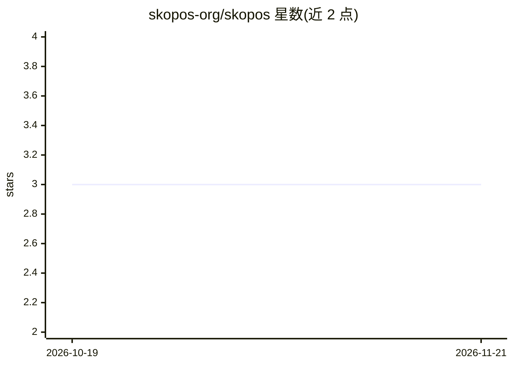

# skopos-org/skopos

⭐ 3 · Elixir · Apache-2.0 · 推送 2026-10-14 · [GitHub](https://github.com/skopos-org/skopos) · [官网](https://skopos-org.github.io/skopos/) · 组织维护

**面向 NOC 团队的 AI 自主事件调查与修复平台**

Skopos 是一个基础设施事件自主处置平台，覆盖从告警到确认恢复的完整流程。其机制是：AI 基于实际观察决定调查与修复方案，而非按预定义 runbook 执行；执行被授权的变更后用新观测验证系统是否恢复，并据此决定下一步，直至确认恢复或将事件连同已收集证据移交人工。提供只读调查、人工审批、AI 审查、完全访问等自主级别控制，并带时间、操作与 AI 用量限额。提供 Web 界面与 CLI 两种交互方式，可接入既有监控系统与 AI 服务。

## 筛选速览

| 维度 | 判定 | 备注 |
|---|---|---|
| AI 角色 | `ai-native` | 本体是模型或模型工具 |
| 许可风险 | `permissive` | Apache-2.0 |
| 部署形态 | `None` |  |
| 模型依赖 | — | README 未给出锁定关系 |
| 硬件要求 | — | 无带数字的原话,不猜 |
| 安装摩擦 | `low` | 无编译、无系统依赖或容器化 |
| 成熟度 | — | 结构信号不足 |

## 能力要点

- AI 依据观察自主决定调查与修复步骤，而非按预定义 runbook 执行
- 可配置自主级别：只读调查/人工审批/AI 审查/完全访问，附时限与用量限额
- 用受影响系统的新观测数据验证恢复
- 保留证据、决策、审批、操作与恢复结果供审查与交接

## 适用场景

- 7x24 NOC 运维中自动调查和处置基础设施告警
- 在人工审批模式下让 AI 提出修复方案并由人确认执行
- 定期主动巡检，发现监控未报告的运维与安全问题
- 事后回溯事件处置过程的证据与决策链

## 场景标签

`工作流自动化` · 领域:效率与自动化

## 证据(README 行号)

> L3: Skopos is an AI-powered platform for autonomous infrastructure incident resolution,
> L7: AI decides what to investigate and how to remediate each incident based on

## 星数曲线

2026-10-19 3 → 2026-11-21 3（+0）

---
*卡片 v1 · prompt 1.4 · 生成 2026-11-21 · 置信度 mid · 依据 README sha `92cb6e127acd` · [字段定义](../../DATASET.md)*
