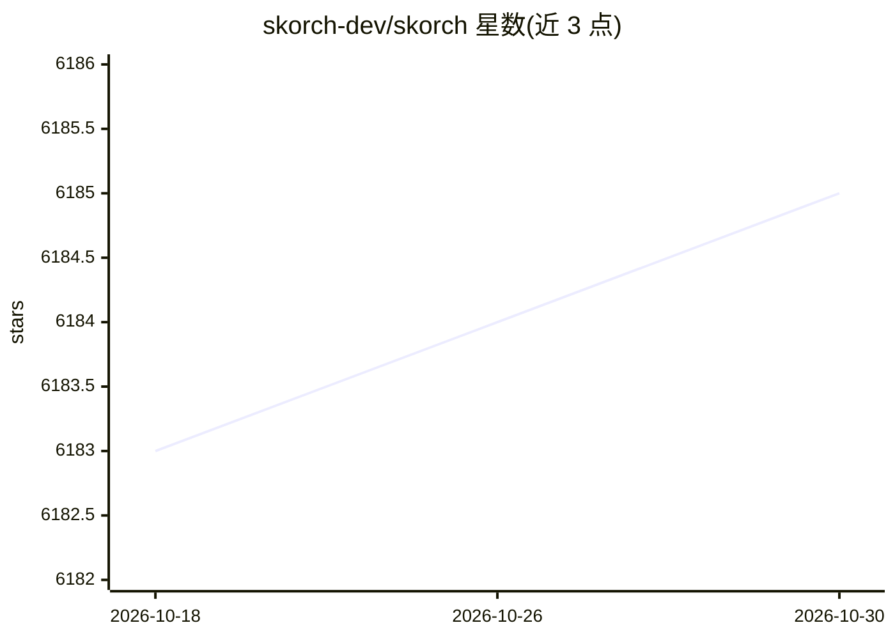

# skorch-dev/skorch

⭐ 6,185 · Jupyter Notebook · BSD-3-Clause · 推送 2026-10-26 · [GitHub](https://github.com/skorch-dev/skorch) · 组织维护

**包装 PyTorch 的 scikit-learn 兼容神经网络训练库**

skorch 是一个 Python 库，将 PyTorch 模块包装为 scikit-learn 风格的 estimator（如 NeuralNetClassifier），支持 fit/predict_proba、嵌入 sklearn Pipeline 与 GridSearchCV 网格搜索。内置回调机制提供学习率调度、早停、检查点保存、参数冻结、进度条等功能，并集成 GPyTorch 高斯过程与 Hugging Face。要求 Python 3.9+，PyTorch 不在依赖内需自行安装，官方支持最近四个 PyTorch 小版本。面向希望用 sklearn 工作流训练 PyTorch 神经网络的开发者。

## 筛选速览

| 维度 | 判定 | 备注 |
|---|---|---|
| AI 角色 | `ai-ecosystem` | LLM/agent 周边工具 |
| 许可风险 | `permissive` | BSD-3-Clause |
| 部署形态 | `library` | 以包/库形式分发 |
| 模型依赖 | — | README 未给出锁定关系 |
| 硬件要求 | — | 无带数字的原话,不猜 |
| 安装摩擦 | `low` | 无编译、无系统依赖或容器化 |
| 成熟度 | — | 结构信号不足 |

## 能力要点

- 将 PyTorch 模块包装为 sklearn estimator，可入 Pipeline 与 GridSearchCV
- 回调系统：学习率调度、早停、检查点、参数冻结、进度条
- 与 GPyTorch 高斯过程和 Hugging Face 的集成
- 官方支持最近四个 PyTorch 小版本（当前 2.11.0–2.14.0）

## 适用场景

- 用 scikit-learn 流水线与网格搜索训练 PyTorch 神经网络
- 在 sklearn 代码库中引入深度学习模型而不更换 API 习惯
- 复用 sklearn 评分与交叉验证机制做模型调参

## 场景标签

 · 领域:机器学习框架/工具库

## 证据(README 行号)

> L6: A scikit-learn compatible neural network library that wraps PyTorch.
> L66:  net = NeuralNetClassifier(

## 星数曲线

2026-10-18 6,183 → 2026-10-30 6,185（+2）

---
*卡片 v1 · prompt 1.4 · 生成 2026-10-20 · 置信度 high · 依据 README sha `1840b6286059` · [字段定义](../../DATASET.md)*
