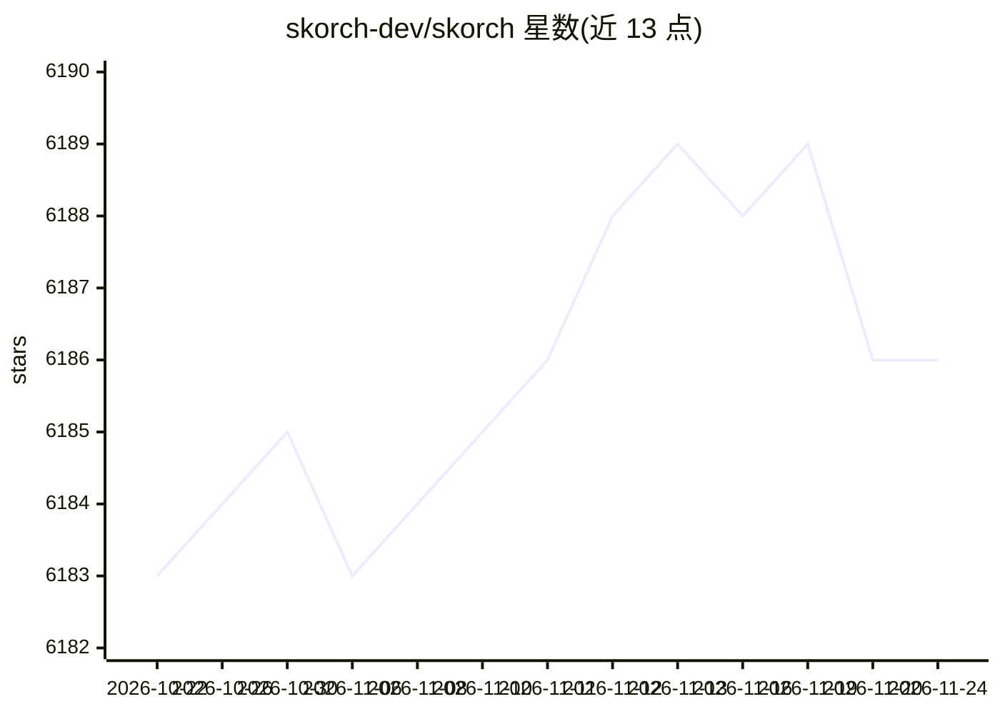

# skorch-dev/skorch

⭐ 6,186 · Jupyter Notebook · BSD-3-Clause · 推送 2026-11-10 · [GitHub](https://github.com/skorch-dev/skorch) · 组织维护

**给 scikit-learn 用户提供兼容 sklearn API 的 PyTorch 神经网络封装库**

skorch 是一个与 scikit-learn 兼容、封装 PyTorch 的神经网络库，提供 NeuralNetClassifier 等封装类，使 PyTorch 模型可用 net.fit/predict_proba 训练与推理，并可嵌入 sklearn Pipeline 与 GridSearchCV 进行网格搜索调参。功能包括学习率调度、早停、检查点、参数冻结/解冻、进度条、CLI 参数自动推断，以及与 GPyTorch（高斯过程）和 Hugging Face 的集成。要求 Python 3.9+，PyTorch 需按系统自行安装。README 声明项目处于低开发阶段，功能开发已停止但仍会维护。

## 筛选速览

| 维度 | 判定 | 备注 |
|---|---|---|
| AI 角色 | `ai-native` | 本体是模型或模型工具 |
| 许可风险 | `permissive` | BSD-3-Clause |
| 部署形态 | `library` | 以包/库形式分发 |
| 模型依赖 | — | README 未给出锁定关系 |
| 硬件要求 | — | 无带数字的原话,不猜 |
| 安装摩擦 | `low` | 无编译、无系统依赖或容器化 |
| 成熟度 | — | 结构信号不足 |

## 能力要点

- NeuralNetClassifier 等封装使 PyTorch 模型可用 sklearn 的 fit/predict API
- 可嵌入 sklearn Pipeline 并配合 GridSearchCV 做网格搜索
- 提供学习率调度、早停、检查点、参数冻结、进度条等回调功能
- 与 Hugging Face 和 GPyTorch 提供集成

## 适用场景

- 在现有 scikit-learn 工作流中使用 PyTorch 训练分类模型
- 用 GridSearchCV 对神经网络超参数做网格搜索
- 训练时添加早停、检查点与进度条等训练控制

## 场景标签

`模型训练` `微调` · 领域:训练与推理

## 证据(README 行号)

> L6: A scikit-learn compatible neural network library that wraps PyTorch.
> L78:  net.fit(X, y)
> L124: - `Integration with Hugging Face 🤗 <https://skorch.readthedocs.io/en/stable/user/huggingface.html>`_

## 星数曲线

2026-10-22 6,183 → 2026-11-24 6,186（+3）

---
*卡片 v1 · prompt 1.4 · 生成 2026-11-22 · 置信度 high · 依据 README sha `d358d84535fe` · [字段定义](../../DATASET.md)*
