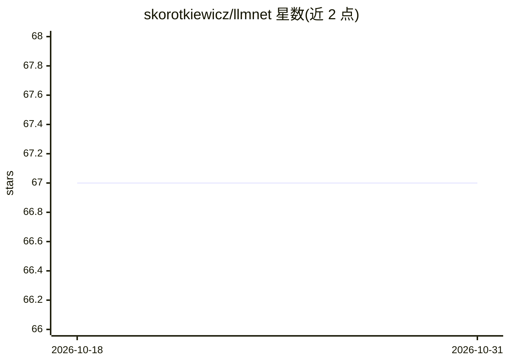

# skorotkiewicz/llmnet

⭐ 67 · TypeScript · 推送 2026-01-28 · [GitHub](https://github.com/skorotkiewicz/llmnet) · 个人维护

**本地离线搜索引擎：把本地 LLM 与 RAG 变成私有搜索体验**

LLMNet 是运行在本机的搜索应用：通过递归爬取网站或 GitHub Wiki，转换为 Markdown 并分块嵌入，存入带 pgvector 与 HNSW 索引的 PostgreSQL 向量数据库，实现亚秒级语义搜索。智能层使用 OpenAI 兼容 API 接入本地 LLM（如 Llama.cpp、Ollama）与本地嵌入服务。前端为 Next.js 界面，用 Bun 运行；索引完成后完全离线可用。限制：需自行准备本地 LLM 服务器、嵌入服务器与 Postgres。

## 筛选速览

| 维度 | 判定 | 备注 |
|---|---|---|
| AI 角色 | `ai-native` | 本体是模型或模型工具 |
| 许可风险 | `none` | — |
| 部署形态 | `None` |  |
| 模型依赖 | local-ok | 支持本地模型 |
| 硬件要求 | — | 无带数字的原话,不猜 |
| 安装摩擦 | `low` | 无编译、无系统依赖或容器化 |
| 成熟度 | — | 结构信号不足 |

## 能力要点

- 递归 BFS 爬取网站/Wiki 并转为 Markdown、分块、嵌入存储
- PostgreSQL + pgvector + HNSW 索引实现亚秒级语义检索
- 通过 OpenAI 兼容 API 接入本地 LLM 服务器
- 索引完成后无需联网，数据不离开本地网络

## 适用场景

- 把文档站点或 GitHub Wiki 做成可语义搜索的本地知识库
- 在完全离线环境下检索自己的知识资料
- 对隐私要求数据不出本机的私有搜索

## 场景标签

`语义搜索` `网页抓取` · 领域:效率与自动化

## 证据(README 行号)

> L5: LLMNet transforms your local LLMs into a structured search engine. It combines the power of local generative AI with
> L24: - **Intelligence:** Local LLMs (via OpenAI-compatible APIs)

## 星数曲线

2026-10-18 67 → 2026-10-31 67（+0）

---
*卡片 v1 · prompt 1.4 · 生成 2026-10-24 · 置信度 high · 依据 README sha `a09f9f0c776c` · [字段定义](../../DATASET.md)*
