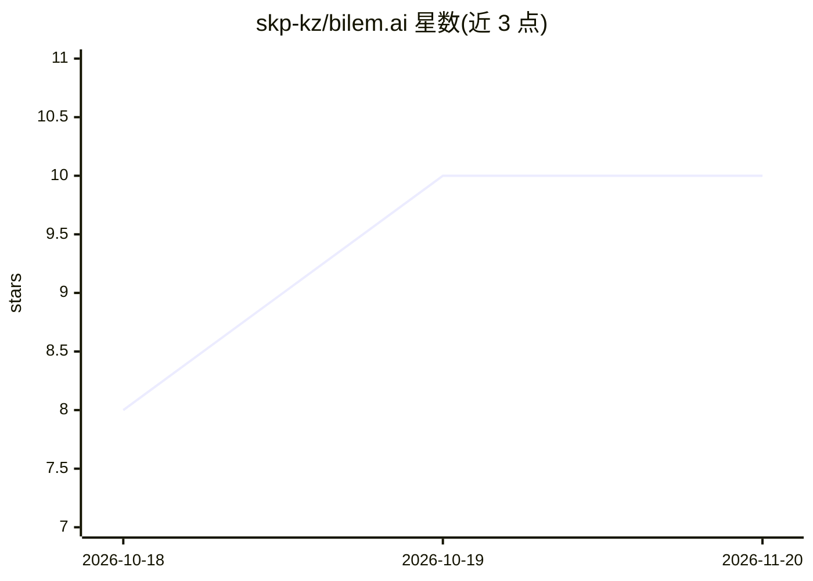

# skp-kz/bilem.ai

⭐ 10 · C# · MIT · 推送 2026-11-16 · [GitHub](https://github.com/skp-kz/bilem.ai) · [官网](https://bilem.ai) · 组织维护

**把哈萨克斯坦 1C 会计账套接入 AI 助手的 Windows MCP 服务**

Windows 桌面程序，以 Windows 服务形式运行 MCP 服务器，将 1C:Предприятие 8.3（验证于哈萨克斯坦会计版 3.0）通过本机 OData 接口（127.0.0.1）接入 Claude、ChatGPT、Cursor 等 AI 助手。回答账面数据（余额、往来、凭证），打印发票、委托书、对账单 PDF 并可经 SMTP 邮件发送；只读访问，不做凭证记账、修改或删除，工资人事数据默认不开放。MSI 安装，内置更新与回滚，MIT 许可。

## 筛选速览

| 维度 | 判定 | 备注 |
|---|---|---|
| AI 角色 | `ai-ecosystem` | LLM/agent 周边工具 |
| 许可风险 | `permissive` | MIT |
| 部署形态 | `desktop` | 安装包/桌面程序 |
| 模型依赖 | — | README 未给出锁定关系 |
| 硬件要求 | — | 无带数字的原话,不猜 |
| 安装摩擦 | `medium` | 含编译或系统依赖之一 |
| 成熟度 | — | 结构信号不足 |

## 能力要点

- 以 MCP 协议将 1C 数据库接入 Claude/ChatGPT/Cursor 等助手
- 通过本机 OData 只读读取 1C 数据，不修改会计记录
- 打印并邮件发送 1C 中已有文档（发票、委托书、对账单）
- 数据默认不出本机；免费模式仅监听 127.0.0.1，可选 Bilem Cloud 经 TLS 出站连接

## 适用场景

- 在 Claude 里用自然语言询问公司账上余额与往来欠款
- 让 AI 助手生成并发送对账单 PDF 给客户
- 给 1C 账套做只读 AI 查询，不动账务数据

## 场景标签

`AI 助手` · 领域:对话与助手

## 证据(README 行号)

> L5: **Bilem Agent** — программа для Windows, которая подключает базы 1С к ИИ-ассистентам (Claude, ChatGPT, Cursor и друг
> L29: |Базы 1С|в каждой подключённой базе — пользователь `bilem` с правами только на чтение (роли подбираются самые узкие
> L33: |Сеть|бесплатный режим: MCP-сервер агента — только `127.0.0.1:8796`, вход по токену. Режим **Bilem Cloud** (галочка

## 星数曲线

2026-10-18 8 → 2026-11-20 10（+2）

---
*卡片 v1 · prompt 1.4 · 生成 2026-11-19 · 置信度 high · 依据 README sha `a6f047cc4801` · [字段定义](../../DATASET.md)*
