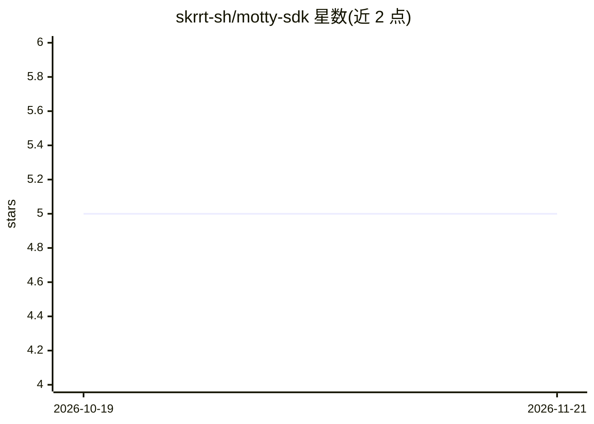

# skrrt-sh/motty-sdk

⭐ 5 · TypeScript · Apache-2.0 · 推送 2026-11-08 · [GitHub](https://github.com/skrrt-sh/motty-sdk) · 个人维护

**用 TypeScript 写模型逻辑的 LLM 网关/中间层 SDK**

Motty SDK 是构建"由代码而非权重构成的模型"的工具包：用户用 TypeScript 编写一个默认导出，它以 Chat Completions、Responses、Messages 三种 API 的形式对外服务，对上层 agent 表现为一个普通模型端点，向下通过适配器调用已有 provider（密钥留在宿主侧）。内置 fallback、race、retry、timeout 组合、流式改写、跨请求状态存储、测试脚本工具包，可充当网关（鉴权、限流、用量报告）。运行时为 Bun/Workers，npm 分发多包。

## 筛选速览

| 维度 | 判定 | 备注 |
|---|---|---|
| AI 角色 | `ai-ecosystem` | LLM/agent 周边工具 |
| 许可风险 | `permissive` | Apache-2.0 |
| 部署形态 | `None` |  |
| 模型依赖 | — | README 未给出锁定关系 |
| 硬件要求 | — | 无带数字的原话,不猜 |
| 安装摩擦 | `low` | 无编译、无系统依赖或容器化 |
| 成熟度 | — | 结构信号不足 |

## 能力要点

- 以三种 Chat API 形式对外服务，客户端仅需改 URL 与模型名
- fallback/race/retry/timeout 可组合，决策模型可选路
- 流式中改写答案与提示词，跨请求共享状态存储
- 脚本化模型的测试套件，无网络跑完整请求

## 适用场景

- 为 coding agent 的子代理设预算并路由到小模型
- 多 provider 同时作答合并为一个模型输出
- 流式输出中执行脱敏等策略规则
- 自建 LLM 网关并保留宿主侧密钥

## 场景标签

`模型网关` · 领域:Agent 开发

## 证据(README 行号)

> L16: any model, over the Chat Completions, Responses and Messages APIs. The Motty SDK is the
> L19: LLMs are layer 1. A motty is layer 2, built on top of them and below your agents and apps.
> L128: - **It can be your gateway.** The host gives it an auth adapter, a limit on calls, time and body

## 星数曲线

2026-10-19 5 → 2026-11-21 5（+0）

---
*卡片 v1 · prompt 1.4 · 生成 2026-11-21 · 置信度 high · 依据 README sha `412baf0c7637` · [字段定义](../../DATASET.md)*
