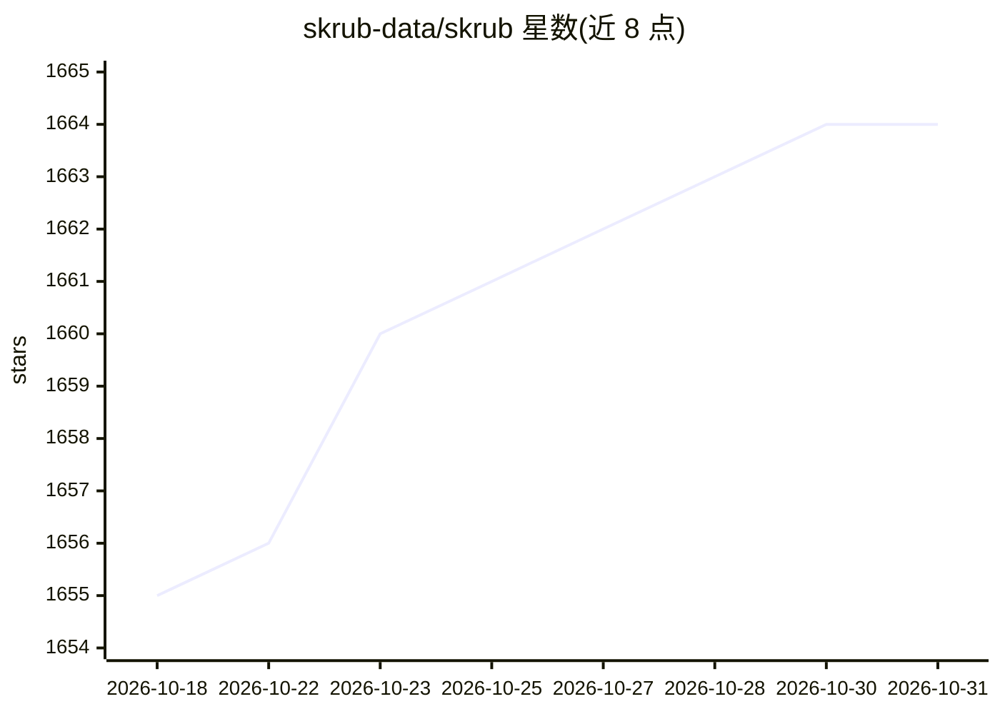

# skrub-data/skrub

⭐ 1,664 · Python · BSD-3-Clause · 推送 2026-10-30 · [GitHub](https://github.com/skrub-data/skrub) · [官网](https://skrub-data.org/) · 组织维护

**面向数据帧的 Python 机器学习预处理库**

skrub 是一个用于在数据帧（dataframe）上开展机器学习的 Python 库，覆盖数据清洗、预处理与面向建模的数据准备工作。文档与示例打包在库内，安装后可通过 skrub.__docs_dir__ 访问；提供官网示例与学习材料，支持 pip 与 conda 安装，并有 Discord 社区、GitHub Discussions 与 issue 渠道。学术使用可通过 Zenodo 记录引用。README 本身未展示具体功能 API 细节。

## 筛选速览

| 维度 | 判定 | 备注 |
|---|---|---|
| AI 角色 | `ai-ecosystem` | LLM/agent 周边工具 |
| 许可风险 | `permissive` | BSD-3-Clause |
| 部署形态 | `library` | 以包/库形式分发 |
| 模型依赖 | — | README 未给出锁定关系 |
| 硬件要求 | — | 无带数字的原话,不猜 |
| 安装摩擦 | `low` | 无编译、无系统依赖或容器化 |
| 成熟度 | — | 结构信号不足 |

## 能力要点

- Python 库，面向数据帧的机器学习工作流
- 文档与示例随包分发，安装后本地可访问
- 支持 pip 与 conda 安装

## 适用场景

- 在 pandas 等数据帧上做机器学习前的数据准备与清洗
- 通过内置示例与学习材料上手数据预处理
- 科研工作中处理脏数据并按 Zenodo 记录引用

## 场景标签

 · 领域:数据科学/机器学习工具

## 证据(README 行号)

> L19: **skrub** is a Python library that facilitates machine learning with dataframes.
> L39: skrub can easily be installed via ``pip`` or ``conda``. For more installation information, see

## 星数曲线

2026-10-18 1,655 → 2026-10-31 1,664（+9）

---
*卡片 v1 · prompt 1.4 · 生成 2026-10-21 · 置信度 mid · 依据 README sha `d34ade285691` · [字段定义](../../DATASET.md)*
