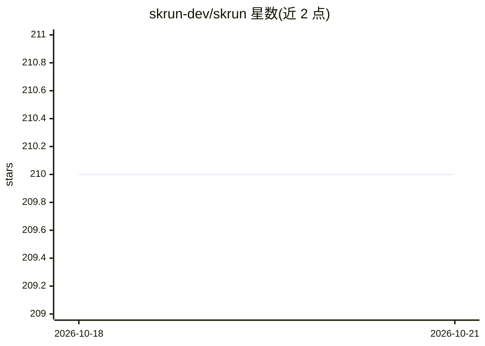

# skrun-dev/skrun

⭐ 210 · TypeScript · MIT · 推送 2026-09-22 · [GitHub](https://github.com/skrun-dev/skrun) · [官网](https://github.com/skrun-dev/skrun) · 组织维护

**将 Agent Skill 部署为 POST /run API 的多模型自托管运行时**

开源 agent 运行时：把以 SKILL.md、AGENTS.md 或自定义格式声明的技能通过 skrun CLI 部署成 POST /run HTTP 端点，含 SSE 流式事件、异步 webhook 与有状态运行。内置 6 家模型厂商并支持任意 OpenAI 兼容端点（DeepSeek、Ollama、vLLM 等），用户自带 LLM key，可插拔 SQLite/Postgres 存储，自带运维面板（agents/runs/成本/token 统计）。面向 OSS 技能维护者、内部 AI 平台与外包团队，MIT 许可，Node 22+ 自托管，云端功能标注 coming soon，agent 目前仅 private。

## 筛选速览

| 维度 | 判定 | 备注 |
|---|---|---|
| AI 角色 | `ai-ecosystem` | LLM/agent 周边工具 |
| 许可风险 | `permissive` | MIT |
| 部署形态 | `desktop` | 安装包/桌面程序 |
| 模型依赖 | local-ok | 支持本地模型 |
| 硬件要求 | — | 无带数字的原话,不猜 |
| 安装摩擦 | `low` | 无编译、无系统依赖或容器化 |
| 成熟度 | — | 结构信号不足 |

## 能力要点

- SKILL.md/AGENTS.md/自定义格式技能一键部署为 POST /run 端点
- 6 家内置厂商 + 任意 OpenAI 兼容端点（Ollama/vLLM/DeepSeek 等），BYOK
- 自带运维面板：运行记录、token/成本、Playground、API key 管理
- 工具调用（本地脚本 + MCP）、多模态输入、文件 API、版本固定与 agent 验证

## 适用场景

- 我把写的 SKILL.md 技能直接部署成 API，回复 issue 一个 curl 命令
- 团队把存量 LLM 脚本逐步包装为技能，统一面板看成本与失败
- 按客户独立部署技能，模型切换只改配置

## 场景标签

 · 领域:AI Agent 基础设施

## 证据(README 行号)

> L5:  Deploy any Agent as an API via <code>POST /run</code>.
> L40: **Skrun is the open agent runtime.** Turn your skill — declared as `SKILL.md`, `AGENTS.md`, or your own format — in
> L152: |🤖 **Multi-model**|6 built-in providers (Anthropic, OpenAI, Google, Mistral, Groq, xAI) + any OpenAI-compatible en

## 星数曲线

2026-10-18 210 → 2026-10-21 210（+0）

---
*卡片 v1 · prompt 1.4 · 生成 2026-10-22 · 置信度 mid · 依据 README sha `8562043f81d9` · [字段定义](../../DATASET.md)*
