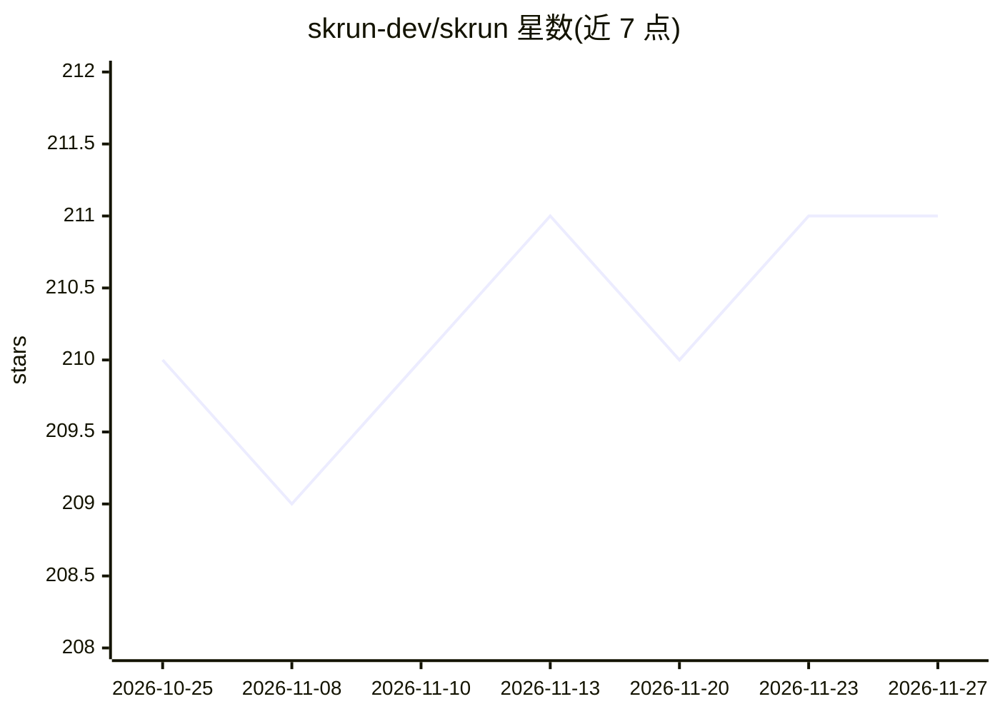

# skrun-dev/skrun

⭐ 211 · TypeScript · MIT · 推送 2026-11-18 · [GitHub](https://github.com/skrun-dev/skrun) · [官网](https://github.com/skrun-dev/skrun) · 组织维护

**把 Agent Skill 部署为 POST /run API 的开源多模型运行时**

Skrun 是开源 agent 运行时：将 SKILL.md、AGENTS.md 或自定义格式声明的 skill 转为 POST /run HTTP 端点，内置 agent 循环，无需自建。支持 6 个内置模型提供方及任意 OpenAI 兼容端点并自动回退，支持 SSE 流式、异步 webhook、KV 状态、MCP 工具调用、版本固定与多租户配额。自托管需 Node 22.19+ 与 SQLite/Postgres，另提供托管云、npm CLI、TypeScript SDK 与运维仪表盘。目标用户是 skill 维护者、内部 AI 平台团队与代理交付机构。

## 筛选速览

| 维度 | 判定 | 备注 |
|---|---|---|
| AI 角色 | `ai-ecosystem` | LLM/agent 周边工具 |
| 许可风险 | `permissive` | MIT |
| 部署形态 | `desktop` | 安装包/桌面程序 |
| 模型依赖 | local-ok | 支持本地模型 |
| 硬件要求 | — | 无带数字的原话,不猜 |
| 安装摩擦 | `low` | 无编译、无系统依赖或容器化 |
| 成熟度 | — | 结构信号不足 |

## 能力要点

- SKILL.md/AGENTS.md 兼容，skill 以 POST /run 端点交付
- 6 个内置模型提供方 + OpenAI 兼容端点，自动回退与原生提示缓存
- SSE 流式事件、异步 webhook、KV 跨运行状态
- 运维仪表盘、多租户 GitHub OAuth 认证与按账户配额

## 适用场景

- 把只有 Claude Code 能跑的 SKILL.md 开放为 API 供 CI/外部集成调用
- 内部团队将零散 LLM 脚本收拢到统一仪表盘并按功能核算成本
- 代理交付客户时复用同一 skill 格式，客户可自行换模型与自托管

## 场景标签

`Agent 框架` `模型网关` · 领域:Agent 开发

## 证据(README 行号)

> L5:  Deploy any Agent as an API via <code>POST /run</code>.
> L40: **Skrun is the open agent runtime.** Turn your skill — declared as `SKILL.md`, `AGENTS.md`, or your own format — in
> L50: - ✅ MIT. Multi-model: Claude, GPT, Gemini, Mistral, Groq, Grok, Ollama.

## 星数曲线

2026-10-25 210 → 2026-11-27 211（+1）

---
*卡片 v1 · prompt 1.4 · 生成 2026-11-25 · 置信度 high · 依据 README sha `77a2a76bd5f7` · [字段定义](../../DATASET.md)*
