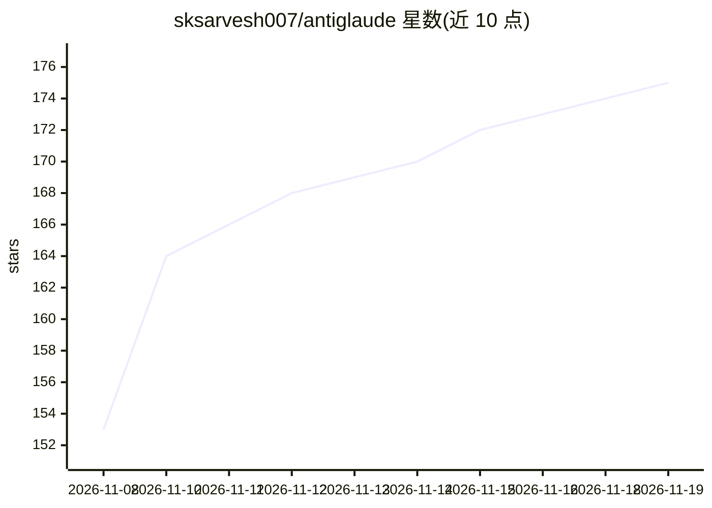

# sksarvesh007/antiglaude

⭐ 175 · Python · MIT · 推送 2026-11-08 · [GitHub](https://github.com/sksarvesh007/antiglaude) · [官网](https://github.com/sksarvesh007/antiglaude-bridge#readme) · 个人维护

**本地协议网关：让 Claude Code 与 OpenAI 工具链调用 Google/Gemini 上游模型**

基于 FastAPI 的本地协议网关与推理服务：将 Anthropic Messages 与 OpenAI Chat Completions 请求转换为 Google Cloud Code 与 Gemini 执行格式，使 Claude Code CLI 及标准 AI 工具链（LangChain、Cursor、Continue 等）可对接 gemini-3-flash、gemini-2.5-pro 等上游模型。关键机制包括：后台自动续期 60 分钟过期的访问令牌、双向 AST 规范化解决 protobuf schema 不兼容、SSE keep-alive 心跳与重试故障转移、任意模型标识符的启发式回退映射。提供 CLI、终端监控面板与 macOS launchd 后台服务；README 明确警告 Google 会封禁使用非官方代理的账号，需自担风险。

## 筛选速览

| 维度 | 判定 | 备注 |
|---|---|---|
| AI 角色 | `ai-ecosystem` | LLM/agent 周边工具 |
| 许可风险 | `permissive` | MIT |
| 部署形态 | `library` | 以包/库形式分发 |
| 模型依赖 | — | README 未给出锁定关系 |
| 硬件要求 | — | 无带数字的原话,不猜 |
| 安装摩擦 | `low` | 无编译、无系统依赖或容器化 |
| 成熟度 | — | 结构信号不足 |

## 能力要点

- Anthropic Messages 与 OpenAI Chat Completions 双协议转换
- 从本地应用状态提取刷新凭据并后台续期访问令牌
- 双向 AST 规范化保证工具调用与 protobuf 兼容
- 终端控制面板实时监控配额、延迟与推理日志

## 适用场景

- 让 Claude Code CLI 通过本地网关使用 Gemini 上游模型
- 为 LangChain/Cursor/AutoGen 等 OpenAI 兼容客户端提供统一本地端点
- 在 macOS 上以后台服务方式常驻运行网关

## 场景标签

`模型网关` · 领域:Agent 开发

## 证据(README 行号)

> L13: A high-performance local protocol gateway and inference server. Antiglaude translates Anthropic Messages and OpenAI
> L153: Antiglaude Bridge provides a drop-in `/v1/chat/completions` endpoint for standard OpenAI SDKs and third-party AI f
> L24: - **Token Expiration**: Upstream access tokens expire after 60 minutes. Antiglaude Bridge extracts permanent refres

## 星数曲线

2026-11-08 153 → 2026-11-19 175（+22）

---
*卡片 v1 · prompt 1.4 · 生成 2026-11-18 · 置信度 high · 依据 README sha `39af4d95a01a` · [字段定义](../../DATASET.md)*
