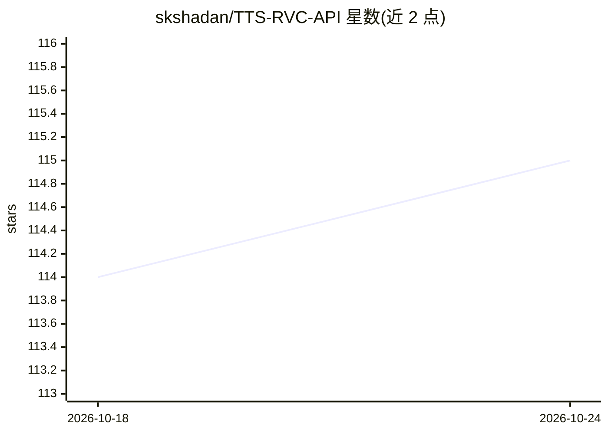

# skshadan/TTS-RVC-API

⭐ 115 · Python · MIT · 推送 2025-11-30 · [GitHub](https://github.com/skshadan/TTS-RVC-API) · 个人维护

**将 Coqui TTS 与 RVC 结合的语音生成 API 服务**

基于 FastAPI/uvicorn 的文本转语音服务：先用 Coqui TTS 将文本合成语音，再经 RVC（基于 HuBERT 微调，仅需 2-3 分钟训练数据）转换为目标说话人音色，规避 Coqui 直接克隆声音耗时长的问题。提供 /generate 接口，支持 speaker_name、emotion（happy/sad/angry/dull）、speed 参数，模型目录通过 config.toml 配置。以 Python 源码方式运行，适合需要 HTTP 调用 TTS 的开发者。

## 筛选速览

| 维度 | 判定 | 备注 |
|---|---|---|
| AI 角色 | `ai-native` | 本体是模型或模型工具 |
| 许可风险 | `permissive` | MIT |
| 部署形态 | `library` | 以包/库形式分发 |
| 模型依赖 | — | README 未给出锁定关系 |
| 硬件要求 | — | 无带数字的原话,不猜 |
| 安装摩擦 | `low` | 无编译、无系统依赖或容器化 |
| 成熟度 | — | 结构信号不足 |

## 能力要点

- Coqui TTS 合成 + RVC 音色转换的两阶段流水线
- RVC 模型仅需 2-3 分钟数据训练（基于 HuBERT）
- HTTP POST /generate 接口，支持 emotion 与 speed 参数

## 适用场景

- 通过 API 调用定制音色的文本转语音
- 用少量录音数据快速构建个人音色 TTS 服务
- 集成到需要语音生成的应用后端

## 场景标签

`语音合成` · 领域:内容生成

## 证据(README 行号)

> L3: Yes, we can use Coqui with RVC!
> L7: Coqui is a text-to-speech framework (vocoder and encoder), but cloning your own voice takes decades and offers no gu
> L21: python -m uvicorn app.main:app

## 星数曲线

2026-10-18 114 → 2026-10-24 115（+1）

---
*卡片 v1 · prompt 1.4 · 生成 2026-10-23 · 置信度 high · 依据 README sha `24b9441ffdc4` · [字段定义](../../DATASET.md)*
