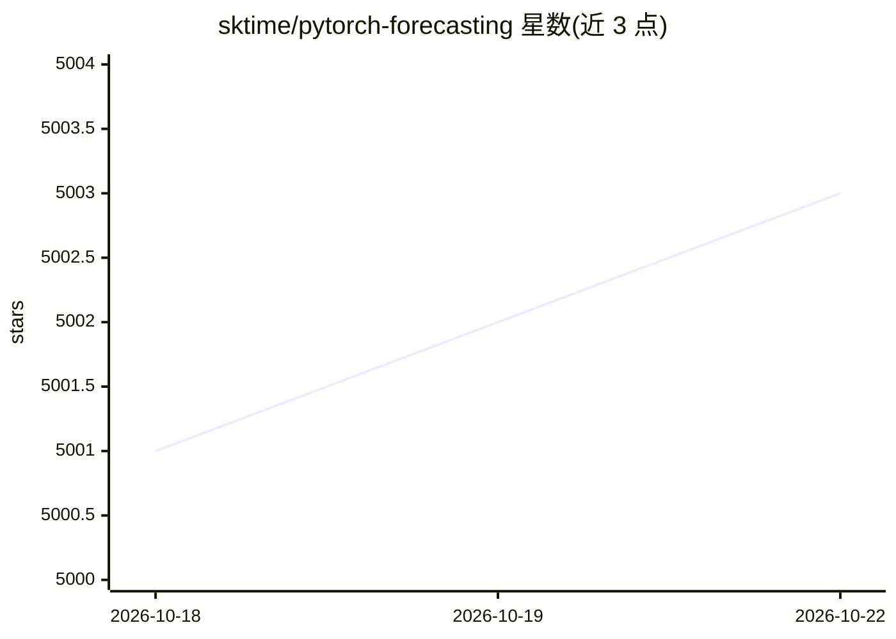

# sktime/pytorch-forecasting

⭐ 5,003 · Python · MIT · 推送 2026-10-21 · [GitHub](https://github.com/sktime/pytorch-forecasting) · [官网](https://pytorch-forecasting.readthedocs.io/) · 组织维护

**基于 PyTorch 的时间序列预测深度学习库**

基于 PyTorch Lightning 的 Python 时间序列预测包，面向实际业务与科研场景，提供高层 API 与合理默认参数。核心机制包括：抽象变量变换、缺失值、随机子采样等处理的 TimeSeriesDataSet 数据类，带 TensorBoard 日志与可视化的基础模型类，以及 Temporal Fusion Transformer、N-BEATS、N-HiTS、DeepAR、PatchTST 等多种预测架构，支持多视野指标、optuna 超参调优，可在 CPU 或单/多 GPU 上开箱训练。

## 筛选速览

| 维度 | 判定 | 备注 |
|---|---|---|
| AI 角色 | `ai-native` | 本体是模型或模型工具 |
| 许可风险 | `permissive` | MIT |
| 部署形态 | `library` | 以包/库形式分发 |
| 模型依赖 | — | README 未给出锁定关系 |
| 硬件要求 | — | 无带数字的原话,不猜 |
| 安装摩擦 | `low` | 无编译、无系统依赖或容器化 |
| 成熟度 | — | 结构信号不足 |

## 能力要点

- TimeSeriesDataSet 抽象变量变换、缺失值、随机子采样等数据处理
- 内置 TFT、N-BEATS、N-HiTS、DeepAR、PatchTST 等多种预测架构
- 基于 PyTorch Lightning，支持 CPU/单/多 GPU 训练与自动日志
- 支持多视野时间序列指标与 optuna 超参调优

## 适用场景

- 用深度学习做真实业务的多视野时间序列预测
- 在研究/竞赛中对比或复现主流预测架构
- 快速上手带合理默认参数的预测建模并逐步调优

## 场景标签

 · 领域:机器学习/时间序列预测

## 证据(README 行号)

> L3: _PyTorch Forecasting_ is a PyTorch-based package for forecasting with state-of-the-art deep learning architectures. 
> L15: PyTorch Forecasting aims to ease state-of-the-art timeseries forecasting with neural networks for real-world cases 
> L22: - Multiple neural network architectures for timeseries forecasting that have been enhanced

## 星数曲线

2026-10-18 5,001 → 2026-10-22 5,003（+2）

---
*卡片 v1 · prompt 1.4 · 生成 2026-10-20 · 置信度 high · 依据 README sha `ee7d713dfb61` · [字段定义](../../DATASET.md)*
