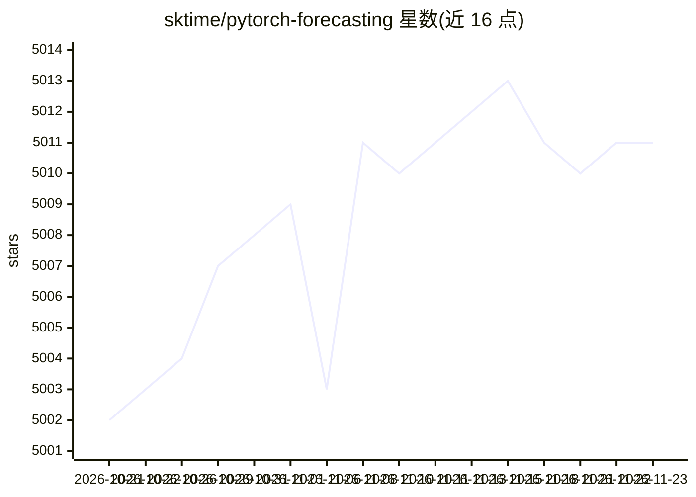

# sktime/pytorch-forecasting

⭐ 5,011 · Python · MIT · 推送 2026-11-21 · [GitHub](https://github.com/sktime/pytorch-forecasting) · [官网](https://pytorch-forecasting.readthedocs.io/) · 组织维护

**面向研究人员与开发者的 PyTorch 时间序列预测库**

基于 PyTorch 的时间序列预测包，提供高层 API 并借助 PyTorch Lightning 支持 CPU、单卡与多卡 GPU 训练及自动日志。内置多种神经网络架构（TFT、N-BEATS、N-HiTS、DeepAR、PatchTST、LSTM/GRU 基线等），附带时间序列数据集类（处理变量变换、缺失值、随机子采样）、TensorBoard 日志与可视化、多步预测指标及 optuna 超参调优。以 pip/conda 安装，文档与教程在 readthedocs；v2 处于 beta，官方建议生产环境使用 v1。

## 筛选速览

| 维度 | 判定 | 备注 |
|---|---|---|
| AI 角色 | `ai-native` | 本体是模型或模型工具 |
| 许可风险 | `permissive` | MIT |
| 部署形态 | `library` | 以包/库形式分发 |
| 模型依赖 | — | README 未给出锁定关系 |
| 硬件要求 | — | 无带数字的原话,不猜 |
| 安装摩擦 | `low` | 无编译、无系统依赖或容器化 |
| 成熟度 | `idea` | |

## 能力要点

- 内置 TFT、N-BEATS、N-HiTS、DeepAR、PatchTST 等多种预测架构
- 基于 PyTorch Lightning，开箱支持 CPU、单/多 GPU 训练
- 数据集类抽象处理变量变换、缺失值与多历史长度
- 支持 optuna 超参调优与内置可解释能力

## 适用场景

- 为真实业务数据训练多步时间序列预测模型
- 科研中对多种神经网络预测架构做对比实验
- 需要可解释预测结果的时序建模任务
- 用 optuna 对预测模型做超参数搜索

## 场景标签

 · 领域:机器学习/时间序列预测

## 证据(README 行号)

> L3: _PyTorch Forecasting_ is a PyTorch-based package for forecasting with state-of-the-art deep learning architectures. 
> L20: PyTorch Forecasting aims to ease state-of-the-art timeseries forecasting with neural networks for real-world cases 

## 星数曲线

2026-10-21 5,002 → 2026-11-23 5,011（+9）

---
*卡片 v1 · prompt 1.4 · 生成 2026-11-22 · 置信度 high · 依据 README sha `9584e3c0b8e3` · [字段定义](../../DATASET.md)*
