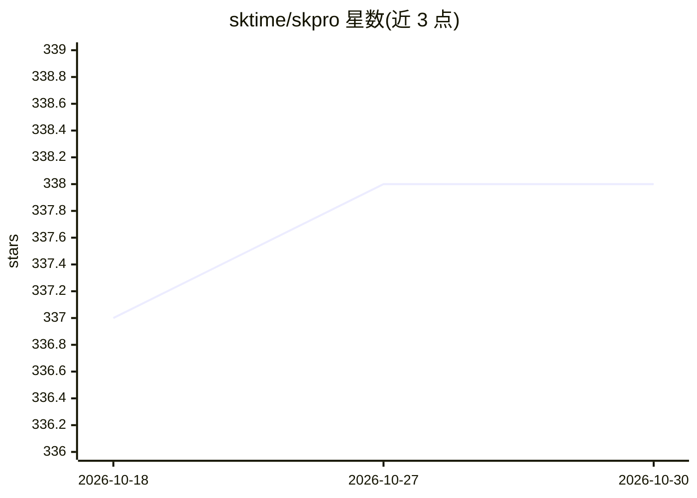

# sktime/skpro

⭐ 338 · Python · BSD-3-Clause · 推送 2026-10-11 · [GitHub](https://github.com/sktime/skpro) · [官网](https://skpro.readthedocs.io/en/latest) · 组织维护

**Python 概率预测库：表格概率回归、生存预测与概率分布**

skpro 是面向监督概率预测的 Python 库，提供 scikit-learn 风格接口，覆盖表格概率回归（区间/分位数/分布预测）、时间到事件与生存预测、概率预测评估指标（pinball loss、CRPS、经验覆盖率、生存损失）。支持将 scikit-learn 回归器通过 bootstrap、conformal 等约简方法转为概率回归器，可构建管道与复合模型并按概率指标调参；另提供以 pandas.DataFrame 为值域的符号概率分布。由 sktime 社区维护，BSD 3-clause 许可。

## 筛选速览

| 维度 | 判定 | 备注 |
|---|---|---|
| AI 角色 | `ai-native` | 本体是模型或模型工具 |
| 许可风险 | `permissive` | BSD-3-Clause |
| 部署形态 | `library` | 以包/库形式分发 |
| 模型依赖 | — | README 未给出锁定关系 |
| 硬件要求 | — | 无带数字的原话,不猜 |
| 安装摩擦 | `low` | 无编译、无系统依赖或容器化 |
| 成熟度 | — | 结构信号不足 |

## 能力要点

- 表格概率回归（区间/分位数/分布预测）与生存预测接口
- 概率预测评估指标：pinball loss、CRPS、经验覆盖率、生存损失
- bootstrap、conformal 等约简将 scikit-learn 回归器转为概率回归器
- 兼容 scikit-learn 与 sktime，可构建管道并按概率指标调参

## 适用场景

- 为表格回归任务输出预测区间或分布而非点预测
- 做个体级生存分布与时间到事件预测
- 用 CRPS 等指标评估概率预测质量

## 场景标签

 · 领域:机器学习/统计预测

## 证据(README 行号)

> L6: * tabular **supervised regressors for probabilistic prediction** - interval, quantile and distribution predictions
> L8: * **metrics to evaluate probabilistic predictions**, e.g., pinball loss, empirical coverage, CRPS, survival losses

## 星数曲线

2026-10-18 337 → 2026-10-30 338（+1）

---
*卡片 v1 · prompt 1.4 · 生成 2026-10-21 · 置信度 high · 依据 README sha `964924058c41` · [字段定义](../../DATASET.md)*
