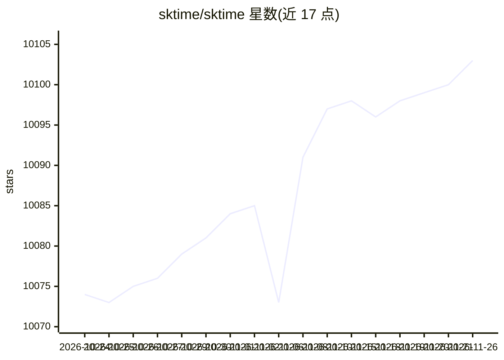

# sktime/sktime

⭐ 10,103 · Python · BSD-3-Clause · 推送 2026-11-25 · [GitHub](https://github.com/sktime/sktime) · [官网](https://www.sktime.net) · 组织维护

**时间序列机器学习统一框架：预测/分类/异常检测统一 API**

Python 的时间序列分析库，为多个时间序列学习任务（预测、分类、回归、聚类、异常/变点检测等）提供统一接口，内置专门的时间序列算法及与 scikit-learn 兼容的组合建模工具（流水线、集成、调参、归约）。同时提供对 scikit-learn、statsmodels、tsfresh、PyOD、fbprophet 等相关库的接口。通过 pip/conda 安装，支持按任务安装软依赖子集；BSD 3-clause 开源，社区维护，提供教程、Binder 示例与扩展模板。

## 筛选速览

| 维度 | 判定 | 备注 |
|---|---|---|
| AI 角色 | `ai-native` | 本体是模型或模型工具 |
| 许可风险 | `permissive` | BSD-3-Clause |
| 部署形态 | `library` | 以包/库形式分发 |
| 模型依赖 | — | README 未给出锁定关系 |
| 硬件要求 | — | 无带数字的原话,不猜 |
| 安装摩擦 | `low` | 无编译、无系统依赖或容器化 |
| 成熟度 | — | 结构信号不足 |

## 能力要点

- 为预测、分类、聚类、异常/变点检测等多任务提供统一接口
- 提供流水线、集成、调参、归约等组合建模工具
- 提供 scikit-learn/statsmodels/tsfresh/PyOD/fbprophet 等库的接口
- 按任务提供 pip 可选依赖集与 conda-forge 安装渠道

## 适用场景

- 做时间序列预测（如航空乘客数据的趋势季节性预测）
- 对时间序列进行分类（如箭头形状数据集）
- 时间序列异常检测与变点检测
- 用 scikit-learn 回归器解决预测任务并构建调参流水线

## 场景标签

 · 领域:数据科学/机器学习

## 证据(README 行号)

> L7: sktime is a library for time series analysis in Python. It provides a unified interface for multiple time series lea
> L47: Our objective is to enhance the interoperability and usability of the time series analysis ecosystem in its entiret

## 星数曲线

2026-10-24 10,074 → 2026-11-26 10,103（+29）

---
*卡片 v1 · prompt 1.4 · 生成 2026-11-22 · 置信度 high · 依据 README sha `7deaabc1cdf7` · [字段定义](../../DATASET.md)*
