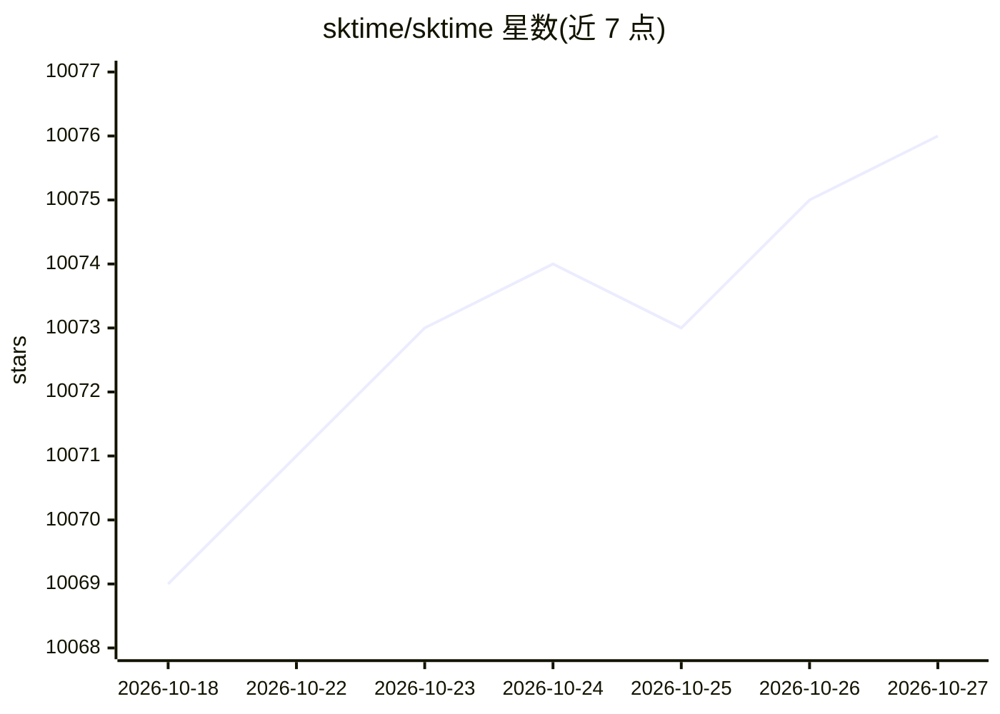

# sktime/sktime

⭐ 10,076 · Python · BSD-3-Clause · 推送 2026-10-25 · [GitHub](https://github.com/sktime/sktime) · [官网](https://www.sktime.net) · 组织维护

**Python 时间序列机器学习统一框架：预测/分类/聚类/检测**

面向时间序列任务的 Python 机器学习库，为预测、时间序列分类、回归、聚类、异常/变点检测等任务提供统一接口。包含专用时间序列算法与 scikit-learn 兼容的组合建模工具（流水线、集成、调参、任务归约），可把一个任务的算法应用到另一任务。提供对 statsmodels、tsfresh、PyOD、fbprophet 等库的接口。通过 pip/conda 安装，支持按学习任务选择依赖集；部分模块（对齐、分布模拟）标注为 experimental。

## 筛选速览

| 维度 | 判定 | 备注 |
|---|---|---|
| AI 角色 | `ai-native` | 本体是模型或模型工具 |
| 许可风险 | `permissive` | BSD-3-Clause |
| 部署形态 | `library` | 以包/库形式分发 |
| 模型依赖 | — | README 未给出锁定关系 |
| 硬件要求 | — | 无带数字的原话,不猜 |
| 安装摩擦 | `low` | 无编译、无系统依赖或容器化 |
| 成熟度 | — | 结构信号不足 |

## 能力要点

- 统一接口覆盖预测、分类、聚类、异常/变点检测等任务
- scikit-learn 兼容的流水线、集成、调参与任务归约工具
- 对 statsmodels/tsfresh/PyOD/fbprophet 等库的互操作接口
- 按学习任务（forecasting/classification 等）可选依赖集安装

## 适用场景

- 构建与调优时间序列预测模型
- 做时间序列分类或异常/变点检测
- 把 scikit-learn 回归器用于预测任务
- 跨库组合时间序列算法做基准评估

## 场景标签

 · 领域:机器学习/时间序列分析

## 证据(README 行号)

> L7: sktime is a library for time series analysis in Python. It provides a unified interface for multiple time series lea
> L47: Our objective is to enhance the interoperability and usability of the time series analysis ecosystem in its entiret

## 星数曲线

2026-10-18 10,069 → 2026-10-27 10,076（+7）

---
*卡片 v1 · prompt 1.4 · 生成 2026-10-20 · 置信度 high · 依据 README sha `d8d9ed80855f` · [字段定义](../../DATASET.md)*
