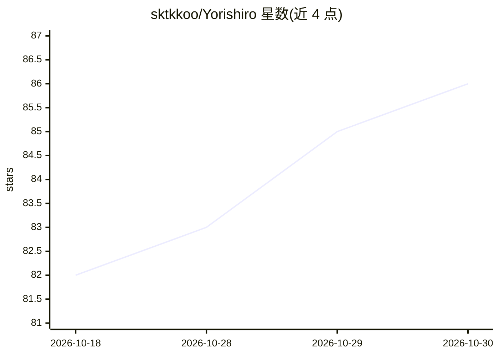

# sktkkoo/Yorishiro

⭐ 86 · TypeScript · MIT · 推送 2026-10-26 · [GitHub](https://github.com/sktkkoo/Yorishiro) · 个人维护 · 中文 README

**让 AI 以虚拟形象常驻的 macOS 终端（Claude Code/Codex）**

基于 Tauri 的 macOS 终端应用，在终端中本地运行 Claude Code 或 Codex，并以 VRM 角色（Yori）呈现：运行中视线游移、报错时表情反应、需批准时灯光提示。用户与 AI 共享同一环境，AI 可实时改灯效、场景与 UI；核心之外的一切通过 packs（persona/scene/effect/ui/ambient-ui/amenity 六类）持久化修改并热重载。支持五种视图模式、外部终端 attach、Codex 语音对话（GPT Live）、屏幕/摄像头共享、自定义 VRM 头像。用户 packs 为本地可信代码，不做沙箱。安装提供 Homebrew cask 与签名公证的 dmg（Apple Silicon/Intel）。

## 筛选速览

| 维度 | 判定 | 备注 |
|---|---|---|
| AI 角色 | `ai-ecosystem` | LLM/agent 周边工具 |
| 许可风险 | `permissive` | MIT |
| 部署形态 | `desktop` | 安装包/桌面程序 |
| 模型依赖 | — | README 未给出锁定关系 |
| 硬件要求 | — | 无带数字的原话,不猜 |
| 安装摩擦 | `low` | 无编译、无系统依赖或容器化 |
| 成熟度 | — | 结构信号不足 |

## 能力要点

- 在终端内本地运行 Claude Code 或 Codex，附带 VRM 角色与场景
- 六类 packs 构成 persona/场景/UI/反应，支持热重载与一键回退
- 五种视图模式与外部终端 companion/attach 命令
- Codex 语音对话（GPT Live）与屏幕/摄像头共享、Agent pointing（实验性）

## 适用场景

- 在终端里以常驻虚拟形象的方式与 Claude Code/Codex 协作
- 通过对话创建和修改 persona 与场景 packs
- 从惯用的外部终端连接 Yorishiro 会话
- 语音或共享屏幕与当前 agent 会话交互

## 场景标签

`编码 Agent` · 领域:编码与开发

## 证据(README 行号)

> L33: Yorishiro runs Claude Code or Codex locally inside its terminal.
> L63: On launch, the configured terminal agent starts inside the terminal and **Yori**, the bundled VRM character, appear
> L65: At launch, Yorishiro starts your preferred agent if available, including when both Claude Code and Codex are instal

## 星数曲线

2026-10-18 82 → 2026-10-30 86（+4）

---
*卡片 v1 · prompt 1.4 · 生成 2026-10-24 · 置信度 high · 依据 README sha `3c82b81655e4` · [字段定义](../../DATASET.md)*
