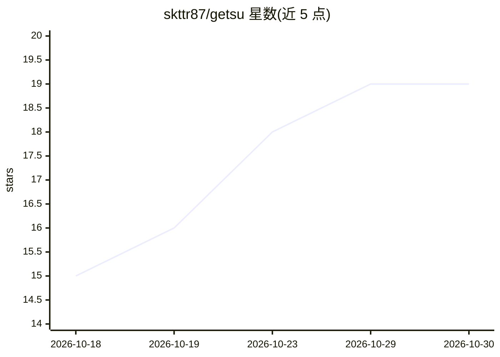

# skttr87/getsu

⭐ 19 · Python · MIT · 推送 2026-10-16 · [GitHub](https://github.com/skttr87/getsu) · [官网](https://skttr87.github.io/getsu/) · 个人维护

**Windows 实时 AI 降噪工具：CPU 上过滤麦克风噪声**

面向 Windows 10/11（64 位）用户的实时麦克风降噪桌面应用：组合 80Hz Butterworth 高通滤波器、Mozilla RNNoise 神经网络与自适应 S-Curve 噪声门，抑制风扇声、机械键盘、背景人声等，处理延迟 <1.2ms、约 1.5% CPU 占用，100% 离线零遥测。通过 VB-Audio 虚拟音频线缆把干净音频路由到 Discord/Steam/Zoom/OBS 等应用。附带 getsu-cli 命令行工具，支持单文件/目录批量音频清洗、音乐模式、增益与 JSON 遥测报告。安装包约 35MB，无签名证书会触发 SmartScreen 警告。

## 筛选速览

| 维度 | 判定 | 备注 |
|---|---|---|
| AI 角色 | `ai-native` | 本体是模型或模型工具 |
| 许可风险 | `permissive` | MIT |
| 部署形态 | `desktop` | 安装包/桌面程序 |
| 模型依赖 | — | README 未给出锁定关系 |
| 硬件要求 | — | 无带数字的原话,不猜 |
| 安装摩擦 | `medium` | 含编译或系统依赖之一 |
| 成熟度 | — | 结构信号不足 |

## 能力要点

- 80Hz 高通 + RNNoise 神经网络 + S-Curve 噪声门三段式流水线，纯 CPU 运行
- getsu-cli 支持批量音频清洗、立体声联动门控、音乐模式与 JSON 遥测导出
- 自动路由到默认麦克风设备，停止时安全恢复原麦克风
- 100% 离线、零遥测、无账户要求，源码公开并发布 SHA-256 校验

## 适用场景

- 游戏语音和 Discord/Zoom 通话中过滤机械键盘与风扇噪声
- 播客与录音的批量后期降噪（CLI 处理 wav/mp3/flac/ogg）
- 无独显的笔记本上做系统级麦克风降噪

## 场景标签

 · 领域:音频处理/桌面工具

## 证据(README 行号)

> L31: Getsu combines an **80Hz Butterworth rumble filter**, the **Mozilla RNNoise neural network**, and an **Adaptive S-C
> L35: |**Stationary Background Noise**|Laptop cooling pads, GPU/CPU fan roar, air conditioning|**RNNoise Neural Spectral 

## 星数曲线

2026-10-18 15 → 2026-10-30 19（+4）

---
*卡片 v1 · prompt 1.4 · 生成 2026-10-28 · 置信度 high · 依据 README sha `e9b5f4f56370` · [字段定义](../../DATASET.md)*
