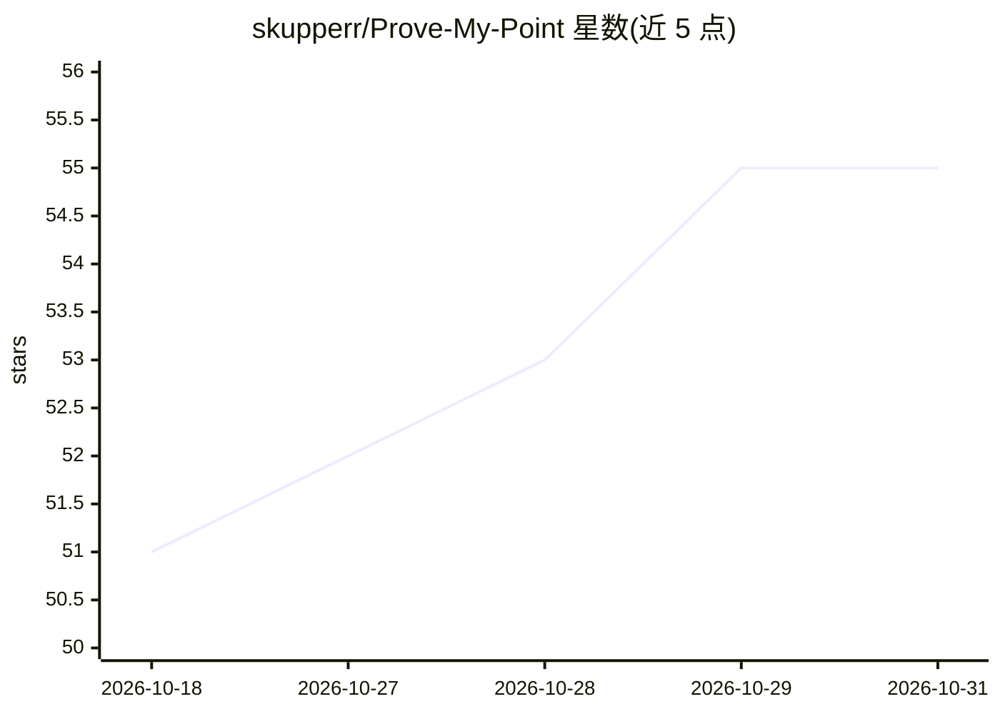

# skupperr/Prove-My-Point

⭐ 55 · JavaScript · MIT · 推送 2026-03-04 · [GitHub](https://github.com/skupperr/Prove-My-Point) · [官网](https://prove-my-point.vercel.app) · 个人维护

**基于学术论文检索的 RAG 问答 Web 助手，回答附引用**

全栈 Web 应用：用户提问后，后端对 PubMed、arXiv、Core、CrossRef、OpenAlex 等学术数据库做向量检索取回相关论文，经 RAG 流水线综合生成带引用链接的回答；登录用户的历史问答保存于 Firebase。前端为 Vite + React（Clerk 认证、Vercel 部署），后端为 FastAPI + LangChain + Sentence Transformer，经 Docker 部署到 Google Cloud Run。面向学生、研究者与内容创作者。README 未给出本地安装运行命令。

## 筛选速览

| 维度 | 判定 | 备注 |
|---|---|---|
| AI 角色 | `ai-native` | 本体是模型或模型工具 |
| 许可风险 | `permissive` | MIT |
| 部署形态 | `None` |  |
| 模型依赖 | — | README 未给出锁定关系 |
| 硬件要求 | — | 无带数字的原话,不猜 |
| 安装摩擦 | `low` | 无编译、无系统依赖或容器化 |
| 成熟度 | — | 结构信号不足 |

## 能力要点

- 仅使用学术论文来源（PubMed/arXiv/Core/CrossRef/OpenAlex）
- 向量检索取回 Top 10 论文后经 RAG 生成回答
- 回答附带原文引用与链接
- 登录用户的历史问答存储于 Firebase

## 适用场景

- 为论文写作查找有引用依据的资料
- 辩论或创作时用真实研究支撑观点
- 向复杂问题获取带学术出处的回答

## 场景标签

`RAG` `科研工具` · 领域:知识与检索

## 证据(README 行号)

> L11: **Prove My Point** is a full-stack AI-powered research assistant designed to help users back their arguments with r
> L48: 3. A **Retrieval-Augmented Generation (RAG)** pipeline analyzes and synthesizes information from those papers to ge

## 星数曲线

2026-10-18 51 → 2026-10-31 55（+4）

---
*卡片 v1 · prompt 1.4 · 生成 2026-10-24 · 置信度 high · 依据 README sha `7cf85752eac2` · [字段定义](../../DATASET.md)*
