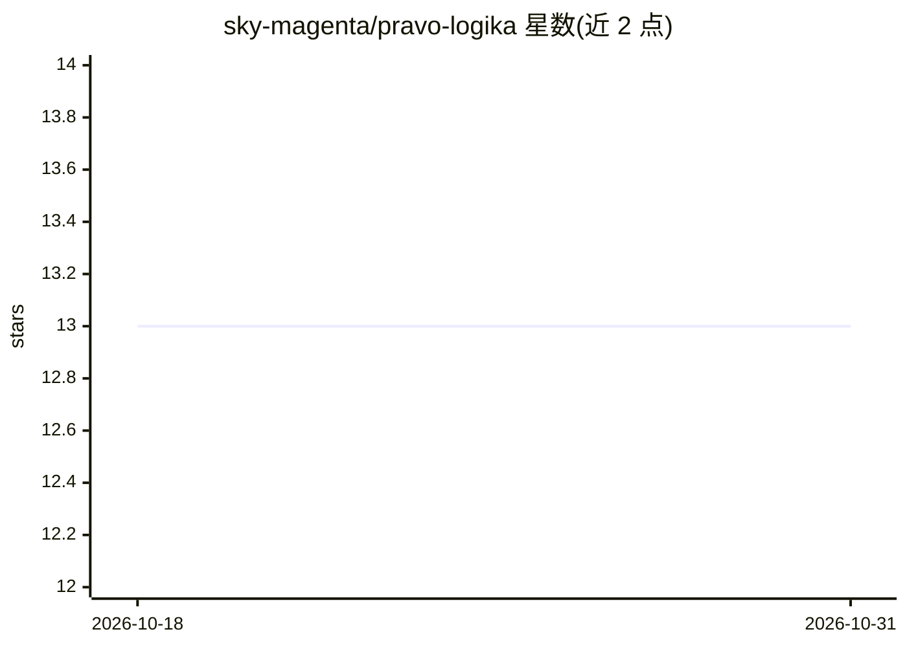

# sky-magenta/pravo-logika

⭐ 13 · Python · NOASSERTION · 推送 2026-09-23 · [GitHub](https://github.com/sky-magenta/pravo-logika) · [官网](https://sky-magenta.github.io/pravo-logika/) · 个人维护

**面向俄罗斯法律从业者的法律论证形式审查技能**

pravo-logika 是一个安装在 AI 助手（Claude Cowork / Claude Code / Cursor / Codex）中的技能包，用于检验俄罗斯联邦法律语境下法律论证的形式：审查备忘录与立场文书的结构、涵摄与解释，检查合同条款的逻辑歧义（定义、列举、'和/或'、阈值、量词），对比双方立场争议地图，并拆解法律条文的假设/处置/制裁结构。仅做诊断，不替换文本内容，不核验实体法正确性——涉及具体法条或判例之处会打上'[需人工核实]'标记。面向律师提供，安装方式为插件市场命令或手动放置文件夹，约 10 分钟，无需编程。

## 筛选速览

| 维度 | 判定 | 备注 |
|---|---|---|
| AI 角色 | `ai-native` | 本体是模型或模型工具 |
| 许可风险 | `none` | NOASSERTION |
| 部署形态 | `None` |  |
| 模型依赖 | locked-api |  |
| 硬件要求 | — | 无带数字的原话,不猜 |
| 安装摩擦 | `low` | 无编译、无系统依赖或容器化 |
| 成熟度 | — | 结构信号不足 |

## 能力要点

- 审查法律论证形式：结构、涵摄、解释，附法律逻辑缺陷目录
- clause-check 检查合同条款的逻辑歧义（'и/или'、量词、模态等）
- 对比两份对立立场文书，标注分歧类型与隐藏前提
- 不核验实体法：具体法条/判例引用处标记[требует проверки]，留给人核查

## 适用场景

- 提交备忘录或代理意见，检查论证结构与涵摄是否成立
- 审查合同条款是否存在逻辑歧义（'和/或'、未定内容条件）
- 对比原告/被告两份文书，找出争议焦点与隐藏前提
- 拆解法条结构（假设/处置/制裁、量词、例外）

## 场景标签

`提示工程` · 领域:Agent 开发

## 证据(README 行号)

> L11: Открытый скилл для проверки **формы** правового рассуждения на материале права РФ. Разбирает юридическую аргументац
> L19: - **Ревью правовой аргументации** — разбор меморандума или позиции: структура, субсумпция, толкование, каталог юрид
> L21: - **Clause-check** — проверка договорной формулировки на логическую однозначность (определения, перечни, условия, с

## 星数曲线

2026-10-18 13 → 2026-10-31 13（+0）

---
*卡片 v1 · prompt 1.4 · 生成 2026-10-31 · 置信度 high · 依据 README sha `095f05fbf793` · [字段定义](../../DATASET.md)*
