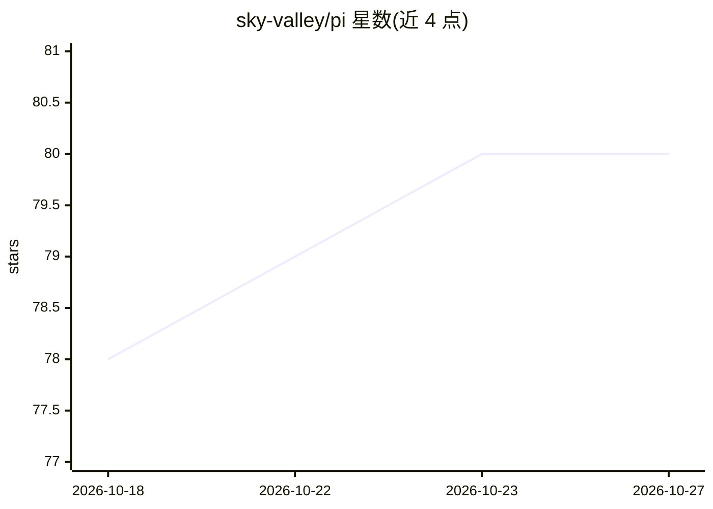

# sky-valley/pi

⭐ 80 · Go · MIT · 推送 2026-10-24 · [GitHub](https://github.com/sky-valley/pi) · 个人维护

**pi agent 工具链的纯 Go 移植：多供应商 LLM API 与编码代理**

将 Mario Zechner 的 pi（pi-ai 统一 LLM API、pi-agent-core 代理循环、pi-coding-agent CLI）移植为纯 Go 实现，无需 Node.js 运行时。提供 Anthropic/OpenAI/Google 三方四类 wire API 适配（SSE 流式、缓存控制、用量计费）、带工具调用与并行执行的代理运行时、八个内置编码工具与 JSONL 会话持久化，以及 pi CLI。内嵌 1,599 个模型目录（42 供应商）。交互式 TUI、扩展运行时及 Bedrock 等部分上游能力尚未移植。

## 筛选速览

| 维度 | 判定 | 备注 |
|---|---|---|
| AI 角色 | `ai-ecosystem` | LLM/agent 周边工具 |
| 许可风险 | `permissive` | MIT |
| 部署形态 | `None` |  |
| 模型依赖 | locked-api |  |
| 硬件要求 | — | 无带数字的原话,不猜 |
| 安装摩擦 | `low` | 无编译、无系统依赖或容器化 |
| 成熟度 | — | 结构信号不足 |

## 能力要点

- 统一多供应商 LLM API：Anthropic/OpenAI/Google，SSE 流式与成本计算
- 代理运行时：工具调用、顺序/并行执行、steering/follow-up 队列、hooks
- 八个内置编码工具（read/write/edit/bash/powershell/ls/find/grep）与 JSONL 会话持久化
- difftest 差分测试框架以原版 pi 请求体为基准校验移植保真度

## 适用场景

- Go 技术栈团队原生运行 pi 编码代理而无需包装 Node.js 进程
- 通过 SDK（coding.NewSession）把 pi 编码代理嵌入自己的应用
- 使用 pi CLI 做单次提示或交互式 REPL 编码会话

## 场景标签

`编码 Agent` · 领域:编码与开发

## 证据(README 行号)

> L20: |`ai`|`@earendil-works/pi-ai`|Unified multi-provider LLM API: message/content/tool/model types, the channel-based `
> L22: |`agent`|`@earendil-works/pi-agent-core`|The agent runtime: low-level `AgentLoop`, the stateful `Agent` with tool c
> L24: |`cmd/pi`|`pi` CLI|The `pi` command — print mode, interactive REPL with slash commands, session resume, `pi models`

## 星数曲线

2026-10-18 78 → 2026-10-27 80（+2）

---
*卡片 v1 · prompt 1.4 · 生成 2026-10-24 · 置信度 high · 依据 README sha `511911b683e4` · [字段定义](../../DATASET.md)*
