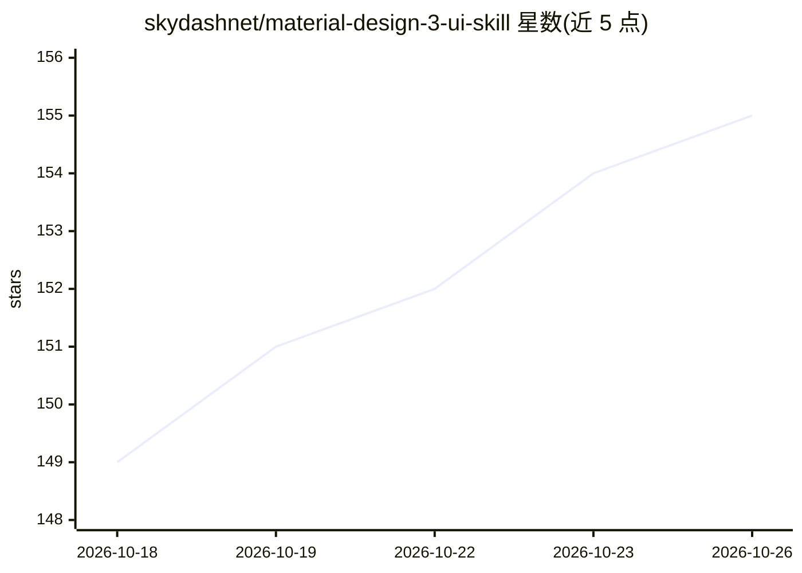

# skydashnet/material-design-3-ui-skill

⭐ 155 · PowerShell · MIT · 推送 2026-09-30 · [GitHub](https://github.com/skydashnet/material-design-3-ui-skill) · 个人维护

**面向 AI 编码代理的 Material Design 3 设计决策技能包**

一个可复用的 Agent Skill：由 SKILL.md 决策入口加 13 个渐进式加载的 references 文件组成，向 AI 设计/编码代理提供 Material Design 3 的语义组件选择规则、自适应布局（compact 至 extra-large 五档窗口）、无障碍要求（触控目标、对比度、屏幕阅读器等）与可选的 M3 Expressive 使用规范，并附静态校验与行为评估用例。安装器仅做文件复制到各代理的全局技能目录，不安装或配置代理本身。

## 筛选速览

| 维度 | 判定 | 备注 |
|---|---|---|
| AI 角色 | `ai-knowledge` | 知识聚合/清单类 |
| 许可风险 | `permissive` | MIT |
| 部署形态 | `None` |  |
| 模型依赖 | locked-api |  |
| 硬件要求 | — | 无带数字的原话,不猜 |
| 安装摩擦 | `low` | 无编译、无系统依赖或容器化 |
| 成熟度 | — | 结构信号不足 |

## 能力要点

- SKILL.md 决策入口按需路由到 13 个专项 reference 文件
- 组件按用途/行为而非外观选择的语义规则，覆盖 30 余种 M3 组件
- 自适应窗口五档分级与折叠屏/桌面布局指引
- 一键安装到 7 种 AI 代理（Claude Code、Codex、Antigravity 等）的全局技能目录

## 适用场景

- 让编码代理按 M3 规范实现或重构界面
- 审查现有界面是否误用 Material 组件语义
- 跨多个 AI 代理统一分发的团队设计规范

## 场景标签

 · 领域:设计系统/前端开发

## 证据(README 行号)

> L5: A reusable **Agent Skill** that helps AI design and coding agents create, review, and implement interfaces using **M
> L43: - **Progressive disclosure** — a compact `SKILL.md` routes agents to 13 focused references only when needed.

## 星数曲线

2026-10-18 149 → 2026-10-26 155（+6）

---
*卡片 v1 · prompt 1.4 · 生成 2026-10-22 · 置信度 mid · 依据 README sha `141305b87d80` · [字段定义](../../DATASET.md)*
