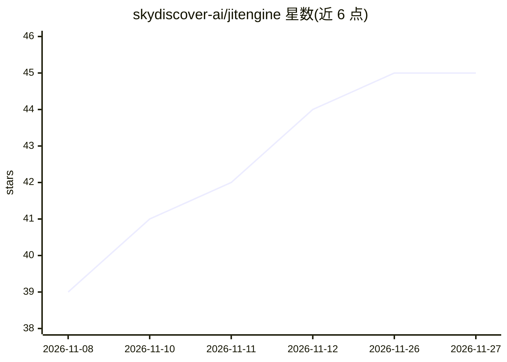

# skydiscover-ai/jitengine

⭐ 45 · Python · Apache-2.0 · 推送 2026-11-25 · [GitHub](https://github.com/skydiscover-ai/jitengine) · [官网](https://jitengine.ai) · 组织维护

**面向 Apple silicon Mac 的 LLM serving 引擎集合，附本地 API 服务**

由 UC Berkeley Sky Computing Lab 开发、经 SkyDiscover 流程为特定模型和 Mac 硬件合成的 LLM serving 引擎集合，支持 Qwen3.6-35B-A3B、Qwen3.8-Flash-Next 与 Flint。通过 install.sh 一键安装后以 jitengine 命令启动，在 8080 端口提供 OpenAI 与 Anthropic 兼容 API（含 tool calls），并可一键搭配 Claude Code、Codex、OpenCode、Pi 等编码 agent 使用。限制：仅限 Apple silicon Mac；Flash-Next 需约 220 GB 可用 SSD；部分配置下需 sudo 提升 GPU wired memory 上限。速度对比数据为作者在两台 Mac 上的单用户测试结果。

## 筛选速览

| 维度 | 判定 | 备注 |
|---|---|---|
| AI 角色 | `ai-ecosystem` | LLM/agent 周边工具 |
| 许可风险 | `permissive` | Apache-2.0 |
| 部署形态 | `None` |  |
| 模型依赖 | locked-api |  |
| 硬件要求 | — | 无带数字的原话,不猜 |
| 安装摩擦 | `low` | 无编译、无系统依赖或容器化 |
| 成熟度 | — | 结构信号不足 |

## 能力要点

- 为特定模型与 Mac 硬件（M2/M4 Pro）分别构建的六个 serving 引擎
- 本地提供 OpenAI 与 Anthropic 兼容 API，支持 tool calls
- jitengine claude/codex/opencode/pi 一键在本地模型上运行编码 agent
- 内存不足时自动缩减预算并从 SSD 读取更多 experts（JITENGINE_BUDGET_GIB 可自设）

## 适用场景

- 在 Apple silicon Mac 上本地部署 Qwen3.6/Flash-Next/Flint 模型
- 为 Claude Code、Codex、OpenCode 等编码 agent 提供本地推理后端
- 通过 OpenAI/Anthropic 兼容 API 接入任意客户端

## 场景标签

`推理引擎` · 领域:训练与推理

## 证据(README 行号)

> L11: JITEngine is a collection of LLM serving engines that SkyDiscover builds on the
> L12: fly for specific AI models and hardware (Apple silicon Macs in this case). The six engines featured here decode up 
> L30: The engine serves the OpenAI and Anthropic APIs:

## 星数曲线

2026-11-08 39 → 2026-11-27 45（+6）

---
*卡片 v1 · prompt 1.4 · 生成 2026-11-18 · 置信度 high · 依据 README sha `b4d847afa573` · [字段定义](../../DATASET.md)*
