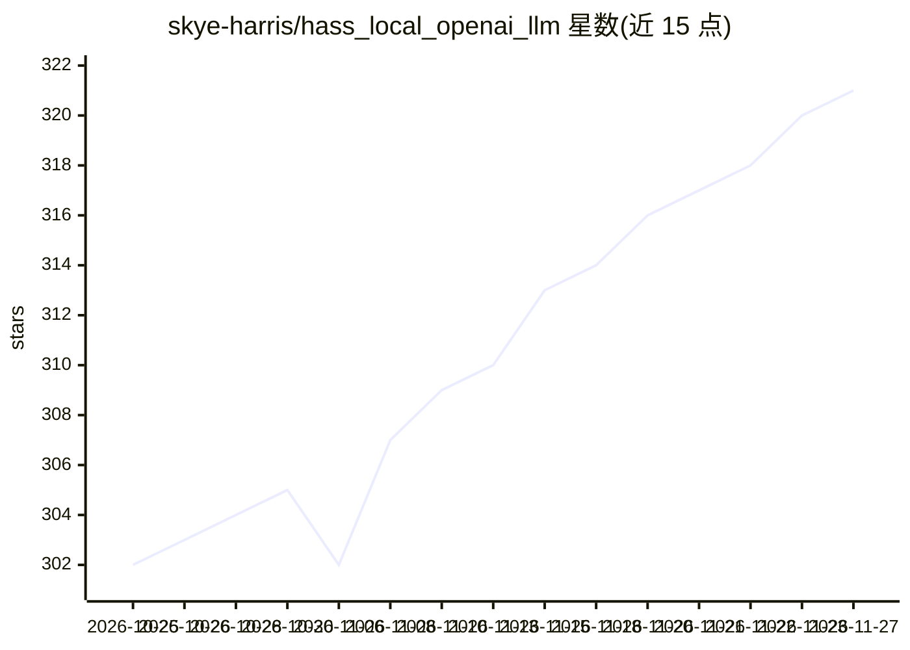

# skye-harris/hass_local_openai_llm

⭐ 321 · Python · Apache-2.0 · 推送 2026-11-26 · [GitHub](https://github.com/skye-harris/hass_local_openai_llm) · 个人维护

**Home Assistant 的本地 OpenAI 兼容 LLM 接入集成**

为 Home Assistant 提供的自定义集成，使用户能通过统一的 OpenAI 兼容 API 接入本地推理服务（llama.cpp、vLLM、LocalAI 等）及云端服务。功能覆盖 Conversation Agent、AI Task 的文本/图像生成、工具调用、TTS 流式输出、RAG、上下文注入与历史裁剪，并针对不同推理服务器提供专门配置项（思考模式、采样参数、thinking token 预算等）。通过 HACS 安装，也可手动复制到 custom_components 目录。

## 筛选速览

| 维度 | 判定 | 备注 |
|---|---|---|
| AI 角色 | `ai-ecosystem` | LLM/agent 周边工具 |
| 许可风险 | `permissive` | Apache-2.0 |
| 部署形态 | `None` |  |
| 模型依赖 | local-ok | 支持本地模型 |
| 硬件要求 | — | 无带数字的原话,不猜 |
| 安装摩擦 | `low` | 无编译、无系统依赖或容器化 |
| 成熟度 | — | 结构信号不足 |

## 能力要点

- 接入任意 OpenAI 兼容 API 服务，API Key 可留空以适配无需鉴权的本地服务
- 针对 llama.cpp / vLLM / LocalAI / DeepSeek Cloud 提供专属配置区块（思考模式、采样参数、Slot ID、token 预算）
- 支持流式响应、TTS 流式输出、图像输入/生成、并行工具调用与实验性 RAG
- 提供上下文注入与对话历史裁剪以控制上下文窗口占用

## 适用场景

- 把 llama.cpp 或 Ollama 等本地推理服务接入 Home Assistant 语音助手
- 在 Home Assistant 中为 AI Task 实体配置本地文本与图像生成
- 配置 Assist 工具调用时需要较长的上下文窗口与可控采样参数

## 场景标签

`模型网关` `AI 助手` · 领域:Agent 开发

## 证据(README 行号)

> L1: # Local OpenAI LLM <small>_(Custom Integration for Home Assistant)_</small>
> L18: **This integration has been forked from Home Assistants OpenRouter integration, with the following changes:**
> L32: - Added experimental Retrieval Augmented Generation capability

## 星数曲线

2026-10-25 302 → 2026-11-27 321（+19）

---
*卡片 v1 · prompt 1.4 · 生成 2026-11-27 · 置信度 high · 依据 README sha `5aa83b2daee4` · [字段定义](../../DATASET.md)*
