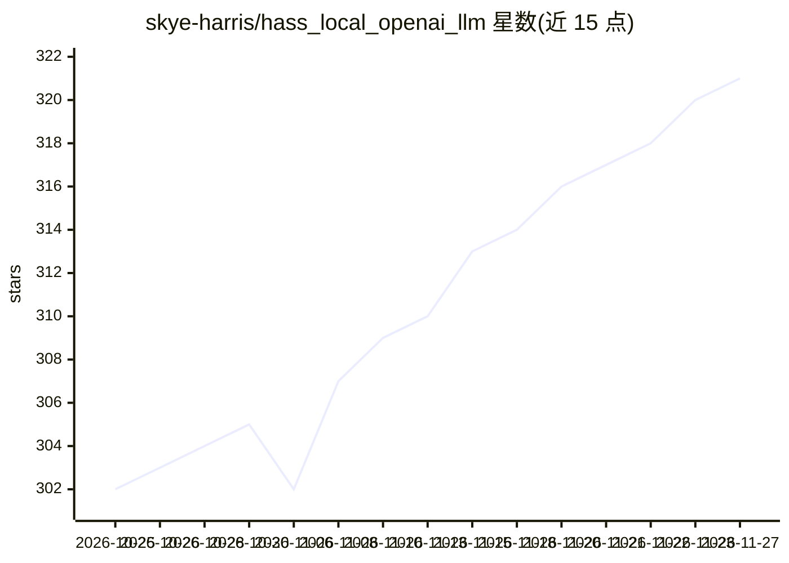

# skye-harris/hass_local_openai_llm

⭐ 321 · Python · Apache-2.0 · 推送 2026-11-26 · [GitHub](https://github.com/skye-harris/hass_local_openai_llm) · 个人维护

**Home Assistant 本地 OpenAI 兼容 LLM 服务集成**

一个 Home Assistant 自定义集成，接入通用 OpenAI 兼容 API 服务，覆盖 llama.cpp、vLLM、LM Studio、Ollama、LocalAI 及 DeepSeek、OpenRouter 等。从 Home Assistant 官方 OpenRouter 集成分叉而来，改动包括：API key 可留空、流式响应、TTS 流式、剥离 think 标签、图像输入/生成、温度控制、并行工具调用、实验性 RAG 等。通过 HACS 或手动复制安装，经 HA UI 配置；建议推理服务端配置至少 10k 上下文并启用 tool calling。

## 筛选速览

| 维度 | 判定 | 备注 |
|---|---|---|
| AI 角色 | `ai-ecosystem` | LLM/agent 周边工具 |
| 许可风险 | `permissive` | Apache-2.0 |
| 部署形态 | `None` |  |
| 模型依赖 | local-ok | 支持本地模型 |
| 硬件要求 | — | 无带数字的原话,不猜 |
| 安装摩擦 | `low` | 无编译、无系统依赖或容器化 |
| 成熟度 | — | 结构信号不足 |

## 能力要点

- 支持 llama.cpp、vLLM、LocalAI、DeepSeek 等多种服务器的专属配置项（thinking mode、采样参数、slot 固定、thinking token budget）
- 流式响应与 TTS 流式，自动剥离 think 标签，支持并行工具调用
- 实验性 RAG 能力、Jinja2 上下文注入与自定义请求头/请求体参数
- HACS 或手动安装，经 Home Assistant UI 配置

## 适用场景

- 在 Home Assistant 中用本地推理服务驱动语音助手对话
- 通过 Assist 工具调用让 LLM 操控家居实体
- 在本地部署中做图像生成/识别类 AI Task
- 为本地 llama.cpp/vLLM 服务配置推理与思考模式参数

## 场景标签

`语音 Agent` `图像生成` · 领域:对话与助手

## 证据(README 行号)

> L1: # Local OpenAI LLM <small>_(Custom Integration for Home Assistant)_</small>
> L3: **Allows use of generic OpenAI-compatible LLM services, such as (but not limited to):**
> L18: **This integration has been forked from Home Assistants OpenRouter integration, with the following changes:**

## 星数曲线

2026-10-25 302 → 2026-11-27 321（+19）

---
*卡片 v1 · prompt 1.4 · 生成 2026-11-25 · 置信度 high · 依据 README sha `d8414c725c3b` · [字段定义](../../DATASET.md)*
