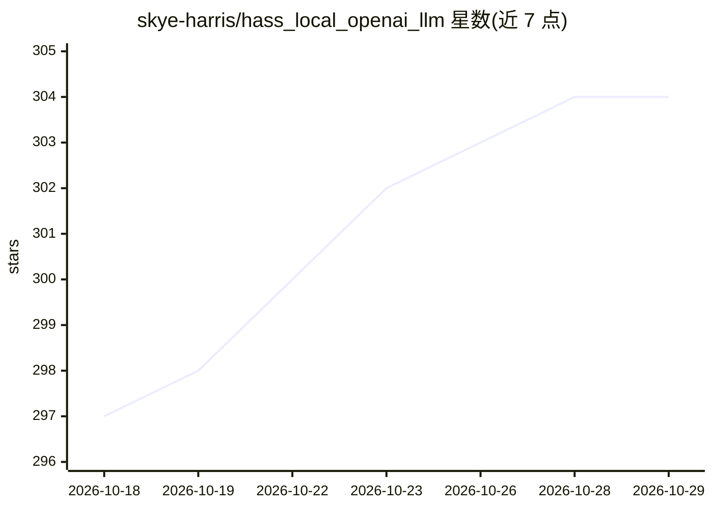

# skye-harris/hass_local_openai_llm

⭐ 304 · Python · Apache-2.0 · 推送 2026-10-25 · [GitHub](https://github.com/skye-harris/hass_local_openai_llm) · 个人维护

**让 Home Assistant 接入本地 OpenAI 兼容 LLM 服务的自定义集成**

从 Home Assistant 官方 OpenRouter 集成 fork 而来的自定义集成，将任意 OpenAI 兼容 API（DeepSeek、llama.cpp、LM Studio、LocalAI、Ollama、OpenRouter、vLLM 等）接入 Home Assistant 的对话代理与 AI Task 实体。改动包括：流式响应与 TTS 流式输出、可选 API key、图像输入、并行工具调用、实验性 RAG、图像生成（测试于 StableDiffusion.cpp），并为 DeepSeek/llama.cpp/LocalAI/vLLM 提供专属服务器类型配置（思考开关、采样参数、思考 token 预算等）。通过 HACS 或手动复制文件安装。

## 筛选速览

| 维度 | 判定 | 备注 |
|---|---|---|
| AI 角色 | `ai-ecosystem` | LLM/agent 周边工具 |
| 许可风险 | `permissive` | Apache-2.0 |
| 部署形态 | `None` |  |
| 模型依赖 | local-ok | 支持本地模型 |
| 硬件要求 | — | 无带数字的原话,不猜 |
| 安装摩擦 | `low` | 无编译、无系统依赖或容器化 |
| 成熟度 | `idea` | |

## 能力要点

- 支持流式 LLM 响应与 TTS 流式输出、并行工具调用
- 为 DeepSeek/llama.cpp/LocalAI/vLLM 提供专属服务器类型配置项
- 支持图像输入与图像生成（AI Task 实体，Images API）
- 自动剥离 <think> 标签、对话历史裁剪、温度控制

## 适用场景

- 把本地 llama.cpp/Ollama/vLLM 服务接入 Home Assistant 语音助手
- 为 Home Assistant AI Task 实体配置文本与图像生成
- 通过本地推理服务控制家居设备而不依赖云端 API

## 场景标签

`AI 助手` `模型网关` · 领域:Agent 开发

## 证据(README 行号)

> L3: **Allows use of generic OpenAI-compatible LLM services, such as (but not limited to):**
> L16: **This integration has been forked from Home Assistants OpenRouter integration, with the following changes:**

## 星数曲线

2026-10-18 297 → 2026-10-29 304（+7）

---
*卡片 v1 · prompt 1.4 · 生成 2026-10-21 · 置信度 high · 依据 README sha `d75b763a68e7` · [字段定义](../../DATASET.md)*
