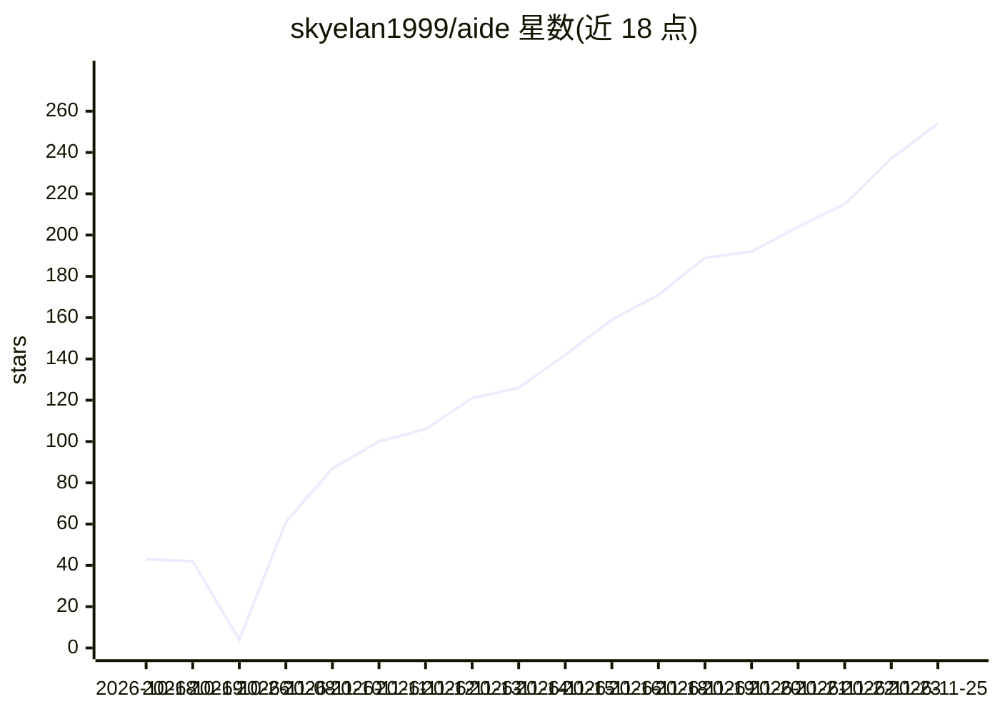

# skyelan1999/aide

⭐ 254 · Go · MIT · 推送 2026-11-24 · [GitHub](https://github.com/skyelan1999/aide) · 个人维护 · 中文 README

**面向开发者的可自托管 AI 工程工作台：模型+工具+文件改动同台**

aide 是可自托管的单用户 AI 工程工作台，将本地或 SSH/SFTP 项目文件、对话、工具、插件与命令纳入同一工作区身份。核心机制包括：模型回答与真实文件写入/命令退出状态分别记录、文件提案经版本校验与审批后汇入主项目、多模型与 Chat Completions/Responses 兼容适配、上下文预算压缩、1X–10X 并行执行环境，以及星图检索与本地 TF-IDF 片段排序。提供 GitHub Releases 发行包与 Docker 源码构建两种路径，默认地址 localhost:8097。

## 筛选速览

| 维度 | 判定 | 备注 |
|---|---|---|
| AI 角色 | `ai-native` | 本体是模型或模型工具 |
| 许可风险 | `permissive` | MIT |
| 部署形态 | `self-host` | docker 或自建部署 |
| 模型依赖 | — | README 未给出锁定关系 |
| 硬件要求 | — | 无带数字的原话,不猜 |
| 安装摩擦 | `low` | 无编译、无系统依赖或容器化 |
| 成熟度 | `idea` | |

## 能力要点

- 文件提案、审批、执行回执与运行轨迹围绕同一任务保存
- 兼容 Chat Completions/Responses 的多模型适配与命名密钥
- 主环境与私有执行环境异步并行，候选汇入主项目经版本校验与审批
- 插件市场独立建库发行，支持 MCP、技能与工具注册

## 适用场景

- 在本地或 SSH 项目上用自选模型执行编码与工作流自动化任务
- 需要审批和可核对文件差异的 AI 辅助开发流程
- 自托管环境中统一管理模型、工具与插件扩展

## 场景标签

`编码 Agent` `工作流自动化` · 领域:效率与自动化

## 证据(README 行号)

> L7: 连接本地或 SSH 项目，用自选模型理解资料、编写与修改文件、调用工具、检查结果。文件提案、审批、执行回执和运行轨迹围绕同一个任务保存。
> L15: aide 是可自托管的 AI 工程工作台，面向可信单用户环境。项目文件、辅助资料、对话、工具、插件和命令共享工作区身份；模型的回答与真正的文件写入、命令退出状态分别记录。

## 星数曲线

2026-10-18 43 → 2026-11-25 254（+211）

---
*卡片 v1 · prompt 1.4 · 生成 2026-11-25 · 置信度 mid · 依据 README sha `bca851db2566` · [字段定义](../../DATASET.md)*
