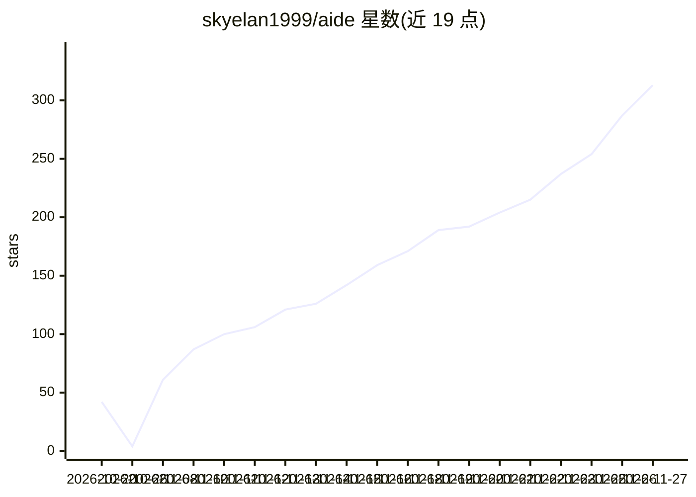

# skyelan1999/aide

⭐ 313 · Go · MIT · 推送 2026-11-26 · [GitHub](https://github.com/skyelan1999/aide) · 个人维护 · 中文 README

**自托管 AI 研发工作台：连接本地/SSH 项目用自选模型执行编码任务**

面向可信单用户环境的自托管 AI 工作台，用 Golang 编写并通过 Docker 构建发行。功能覆盖多轮工具执行与审批、多提供商模型接入（兼容 Chat Completions/Responses）、本地与 SSH/SFTP 工作区、并行执行环境（1X–10X）、文件星图与 TF-IDF 检索、插件市场、SIP 语音与桌面体验。模型回答与实际文件写入、命令退出状态分别记录以便核对；插件协议明确不构成恶意代码隔离沙箱。当前为 v0.1.19.0-RC2 预发布状态。

## 筛选速览

| 维度 | 判定 | 备注 |
|---|---|---|
| AI 角色 | `ai-native` | 本体是模型或模型工具 |
| 许可风险 | `permissive` | MIT |
| 部署形态 | `self-host` | docker 或自建部署 |
| 模型依赖 | — | README 未给出锁定关系 |
| 硬件要求 | — | 无带数字的原话,不猜 |
| 安装摩擦 | `low` | 无编译、无系统依赖或容器化 |
| 成熟度 | `idea` | |

## 能力要点

- 多提供商模型接入，兼容 Chat Completions / Responses 协议
- 文件提案、审批、执行回执与运行轨迹围绕同一任务保存
- 本地与 SSH/SFTP 工作区，支持 1X–10X 并行执行环境
- 插件市场、MCP、技能与浏览器/桌面电脑控制

## 适用场景

- 在本地或远程 SSH 项目上用自选模型执行编码与重构任务
- 要求每次文件写入与命令执行可审批、可回溯的研发流程
- 通过插件扩展专业工具与专用工作台

## 场景标签

`编码 Agent` · 领域:编码与开发

## 证据(README 行号)

> L7: 连接本地或 SSH 项目，用自选模型理解资料、编写与修改文件、调用工具、检查结果。文件提案、审批、执行回执和运行轨迹围绕同一个任务保存。
> L15: AIDE R&D 是可自托管的 AI 研发工作台，面向可信单用户环境。项目文件、辅助资料、对话、工具、插件和命令共享工作区身份；模型的回答与真正的文件写入、命令退出状态分别记录。
> L27: |多模型与上下文|提供商及命名密钥、参数策略、兼容 Chat Completions / Responses 的适配、上下文预算与压缩|

## 星数曲线

2026-10-20 42 → 2026-11-27 313（+271）

---
*卡片 v1 · prompt 1.4 · 生成 2026-11-27 · 置信度 high · 依据 README sha `de7a55a4635b` · [字段定义](../../DATASET.md)*
