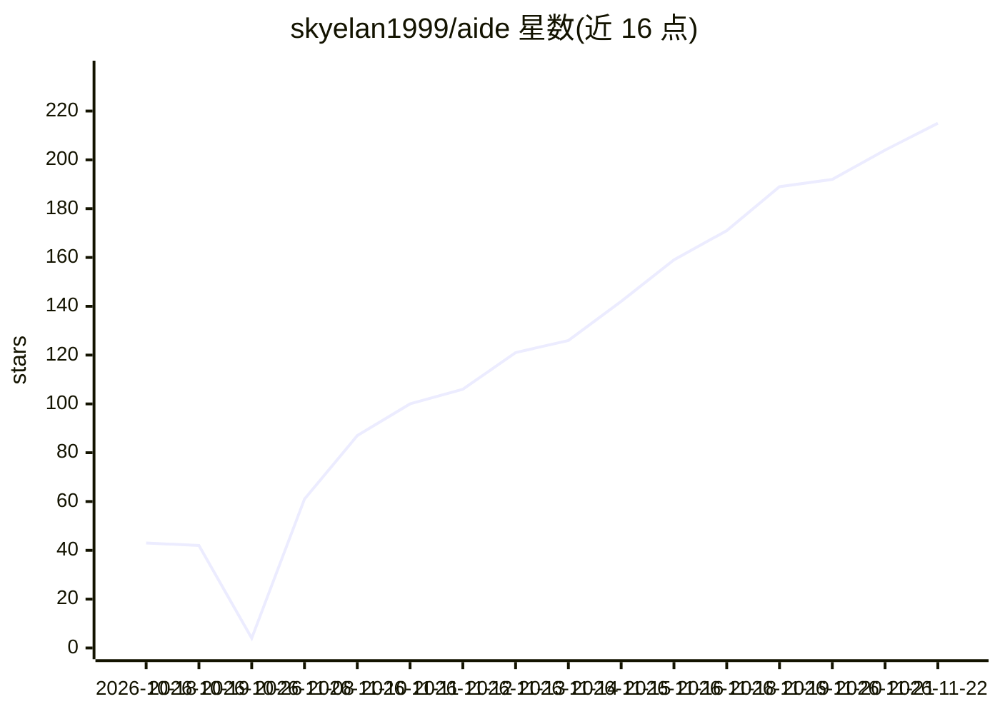

# skyelan1999/aide

⭐ 215 · Go · MIT · 推送 2026-11-21 · [GitHub](https://github.com/skyelan1999/aide) · 个人维护 · 中文 README

**自托管 AI 工程工作台：自带模型在本地/SSH 项目中执行编码与工作流**

面向可信单用户环境的自托管 AI 工作台：连接本地或 SSH/SFTP 项目，用户自选模型提供商与 API Key，执行多轮对话、工具调用、文件提案与命令运行，回答与文件写入、命令退出状态分别记录。支持并行容量（1X～5X、10X）、审批与浏览器电脑控制、插件市场、MCP、本地 TF-IDF 检索。标准源码路径需 Git、Docker Engine、Docker Compose 和 Buildx，发行版从 GitHub Releases 下载。已发布 v0.1.19.0-RC2 预发布。

## 筛选速览

| 维度 | 判定 | 备注 |
|---|---|---|
| AI 角色 | `ai-ecosystem` | LLM/agent 周边工具 |
| 许可风险 | `permissive` | MIT |
| 部署形态 | `self-host` | docker 或自建部署 |
| 模型依赖 | — | README 未给出锁定关系 |
| 硬件要求 | — | 无带数字的原话,不猜 |
| 安装摩擦 | `low` | 无编译、无系统依赖或容器化 |
| 成熟度 | `idea` | |

## 能力要点

- 多轮工具执行、规划审查、暂停继续与审批流程
- 多模型提供商与命名密钥，兼容 Chat Completions / Responses
- 本地与 SSH/SFTP 工作区，文件引用的只读/可写控制
- 独立插件市场与插件协议，插件从市场或 ZIP 安装

## 适用场景

- 开发者用自选模型在本地或远程项目中执行编码与修改任务
- 把 AI 的文件提案、命令执行与审批轨迹集中在一个工作台核对
- 通过插件与 MCP 扩展专业能力与工具集

## 场景标签

`编码 Agent` `工作流自动化` · 领域:效率与自动化

## 证据(README 行号)

> L15: aide 是可自托管的 AI 工程工作台，面向可信单用户环境。项目文件、辅助资料、对话、工具、插件和命令共享工作区身份；模型的回答与真正的文件写入、命令退出状态分别记录。
> L27: |多模型与上下文|提供商及命名密钥、参数策略、兼容 Chat Completions / Responses 的适配、上下文预算与压缩|
> L34: |助理与语音|工作统筹、任务交办、朗读和语音通话；提供商、设备权限和本机能力分别配置|

## 星数曲线

2026-10-18 43 → 2026-11-22 215（+172）

---
*卡片 v1 · prompt 1.4 · 生成 2026-11-17 · 置信度 mid · 依据 README sha `a40e37889078` · [字段定义](../../DATASET.md)*
