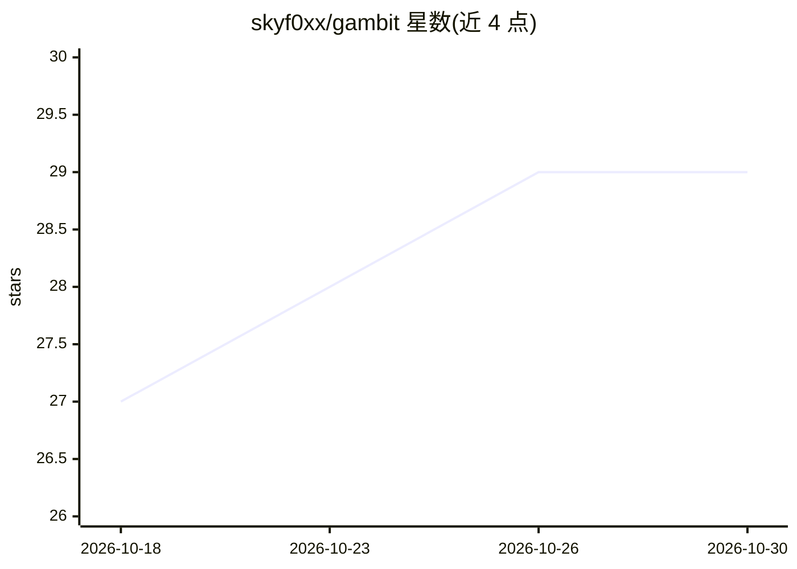

# skyf0xx/gambit

⭐ 29 · TypeScript · MIT · 推送 2026-10-23 · [GitHub](https://github.com/skyf0xx/gambit) · [官网](https://gambit-notes.vercel.app/) · 个人维护

**帮助用户做决策与规划的战略思考型 AI 笔记本应用**

Gambit 是一个本地优先的 PWA 应用，定位为“会思考的笔记本”：结合战略与系统思维、决策与预测、风险与红队分析、利益相关者分析与谈判、规划与执行等框架，帮助用户在创业、营销、健身、人生目标等场景中理清思路、做出决策并推进执行。面向终端用户使用，开发者可通过 npm 安装依赖并本地运行开发版。采用 MIT 许可证。

## 筛选速览

| 维度 | 判定 | 备注 |
|---|---|---|
| AI 角色 | `ai-native` | 本体是模型或模型工具 |
| 许可风险 | `permissive` | MIT |
| 部署形态 | `library` | 以包/库形式分发 |
| 模型依赖 | — | README 未给出锁定关系 |
| 硬件要求 | — | 无带数字的原话,不猜 |
| 安装摩擦 | `low` | 无编译、无系统依赖或容器化 |
| 成熟度 | — | 结构信号不足 |

## 能力要点

- 结合战略思维、决策、风险红队、谈判等框架的分析笔记本
- 以本地优先 PWA 形式提供
- 覆盖商业、营销、健身、人生目标等多类规划场景

## 适用场景

- 创业或开展活动前梳理战略与下一步行动
- 在不确定性下做决策与风险分析
- 把目标拆解为计划并跟踪执行进展

## 场景标签

`知识库管理` · 领域:知识与检索

## 证据(README 行号)

> L13: **Gambit is a strategist** that helps you think it through, **make better decisions, and get things done.**
> L53: Local-first PWA

## 星数曲线

2026-10-18 27 → 2026-10-30 29（+2）

---
*卡片 v1 · prompt 1.4 · 生成 2026-10-26 · 置信度 mid · 依据 README sha `a4d797c372e6` · [字段定义](../../DATASET.md)*
