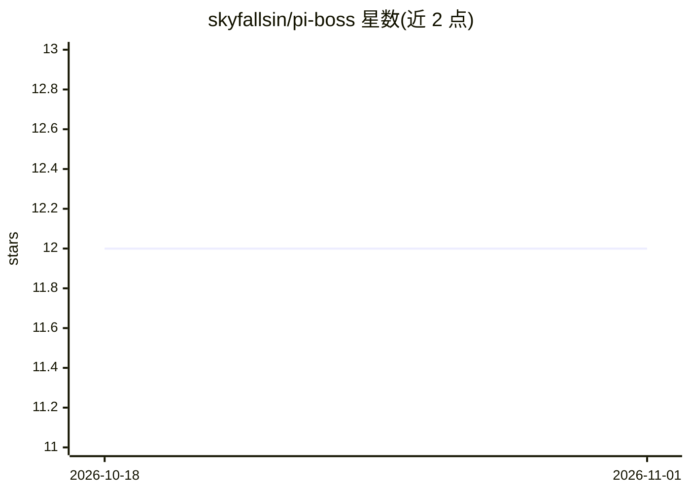

# skyfallsin/pi-boss

⭐ 12 · TypeScript · MIT · 推送 2026-04-25 · [GitHub](https://github.com/skyfallsin/pi-boss) · [官网](https://www.npmjs.com/package/@jo-inc/pi-boss) · 个人维护

**pi 编码 agent 的多子 agent 编排扩展：tmux 分屏并行派活**

pi coding agent 的扩展：通过系统提示注入的 Boss Mode，将任务拆成独立子任务，在 tmux 分屏中并行派生多个 pi agent 实例，每个子 agent 拥有自包含任务。提供 spawn 工具的四种操作（create/list/highlight/kill），主 agent 通过 pi-room 的 peek/steer 监控并干预子 agent，进入 sleep→peek→steer 循环直至全部完成后汇报。要求 pi、pi-room 与 tmux，以 pi install 或 git clone 安装到 ~/.pi/agent/extensions。

## 筛选速览

| 维度 | 判定 | 备注 |
|---|---|---|
| AI 角色 | `ai-ecosystem` | LLM/agent 周边工具 |
| 许可风险 | `permissive` | MIT |
| 部署形态 | `None` |  |
| 模型依赖 | — | README 未给出锁定关系 |
| 硬件要求 | — | 无带数字的原话,不猜 |
| 安装摩擦 | `low` | 无编译、无系统依赖或容器化 |
| 成熟度 | — | 结构信号不足 |

## 能力要点

- boss mode 将任务拆解为子任务并行派生子 agent
- spawn 工具支持 create/list/highlight/kill 四种操作
- 依赖 pi-room 实现子 agent 自动注册与 peek/steer 干预
- 子 agent 通过 PI_SPAWNED/PI_PARENT_PANE 环境变量与 parentSession 关联回主会话

## 适用场景

- 让 pi 编码 agent 并行处理多个独立子任务
- 在 tmux 分屏中可视化监控多个子 agent 的进度与状态
- 对已完成或出错的子 agent 及时干预或终止

## 场景标签

`多智能体` `编码 Agent` · 领域:Agent 开发

## 证据(README 行号)

> L6: Spawn and manage sub-agents in visible tmux panes for pi. The orchestrator that makes boss mode work.

## 星数曲线

2026-10-18 12 → 2026-11-01 12（+0）

---
*卡片 v1 · prompt 1.4 · 生成 2026-11-01 · 置信度 high · 依据 README sha `11c9518f0712` · [字段定义](../../DATASET.md)*
