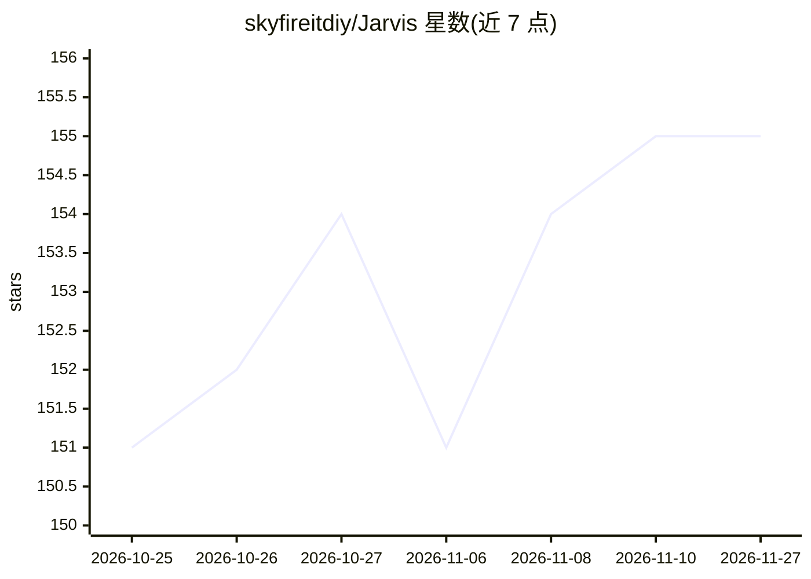

# skyfireitdiy/Jarvis

⭐ 155 · Python · MIT · 推送 2026-11-26 · [GitHub](https://github.com/skyfireitdiy/Jarvis) · 组织维护 · 中文 README

**面向开发者的本地协作式多 Agent AI 开发平台**

Jarvis 是以 CLI、Web 网关和 Python SDK 三种方式访问的协作式 AI 开发平台，覆盖单人单 Agent、单人多 Agent、多人单 Agent、多人多 Agent 四种协作模式。核心机制包括 SQLite 符号数据库做代码影响分析、YAML 声明式多 Agent 编排、JWT 多用户认证与 ACL 权限、多节点分布式部署，以及方法论/规则/记忆三类知识沉淀。运行需 Python 3.12，主要支持 Linux 与 Windows，Docker 为可选方式。多用户协作能力仅通过 Web 接口提供，CLI 面向单人使用。

## 筛选速览

| 维度 | 判定 | 备注 |
|---|---|---|
| AI 角色 | `ai-ecosystem` | LLM/agent 周边工具 |
| 许可风险 | `permissive` | MIT |
| 部署形态 | `desktop` | 安装包/桌面程序 |
| 模型依赖 | — | README 未给出锁定关系 |
| 硬件要求 | — | 无带数字的原话,不猜 |
| 安装摩擦 | `low` | 无编译、无系统依赖或容器化 |
| 成熟度 | — | 结构信号不足 |

## 能力要点

- 覆盖单人/多人 × 单/多 Agent 四种协作模式
- 符号数据库 + 图遍历实现影响分析与风险等级评估
- JWT 多用户认证、ACL 权限与多节点分布式部署
- 内置 Go 编写的 jarvis-daemon 提供本机文件/进程/GUI 自动化能力

## 适用场景

- 把 AI 引入日常代码修改、审查与验证流程
- 一人驱动多个 Agent 组成开发/测试流水线
- 团队共享 Agent 并做跨节点分布式协作
- 执行安全扫描或 C→Rust 迁移等专项任务

## 场景标签

`多智能体` `编码 Agent` · 领域:Agent 开发

## 证据(README 行号)

> L26: Jarvis 是一个面向开发者的 **协作式 AI 开发平台**。它不只是对话工具，还能真正进入工作流：读代码、改代码、执行工具、管理上下文、复用经验，并在关键节点保持可控。
> L28: 它的核心命题是：**让 Agent 从「独自工作」走向「与众共事」**。AI 开发工具的协作能力可以从两个维度交叉分析——**人的维度**（单人 vs 多人）与 **Agent 的维度**（单个 vs 多个），由此得到四种协作模式
> L52: 四种模式层层递进：**单人单 Agent 是基础，单人多 Agent 是扩展，多人单 Agent 是共享，多人多 Agent 是终极形态**。主流工具（Claude Code、CodeX、CodeBuddy）聚焦「单人单 Agen

## 星数曲线

2026-10-25 151 → 2026-11-27 155（+4）

---
*卡片 v1 · prompt 1.4 · 生成 2026-11-27 · 置信度 high · 依据 README sha `ad82e7a356ee` · [字段定义](../../DATASET.md)*
